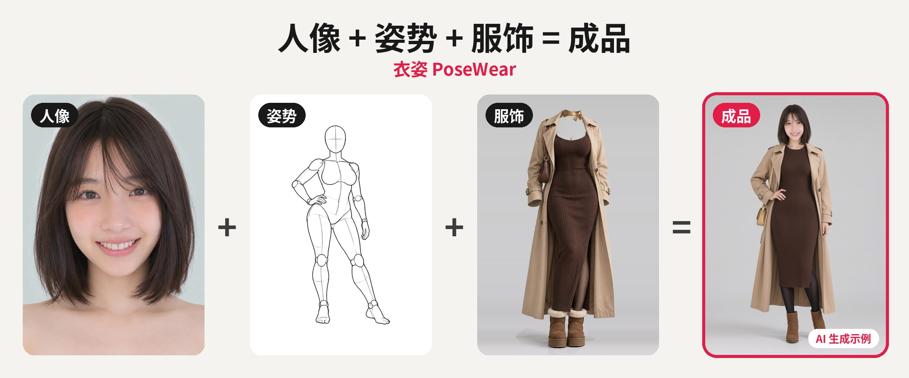
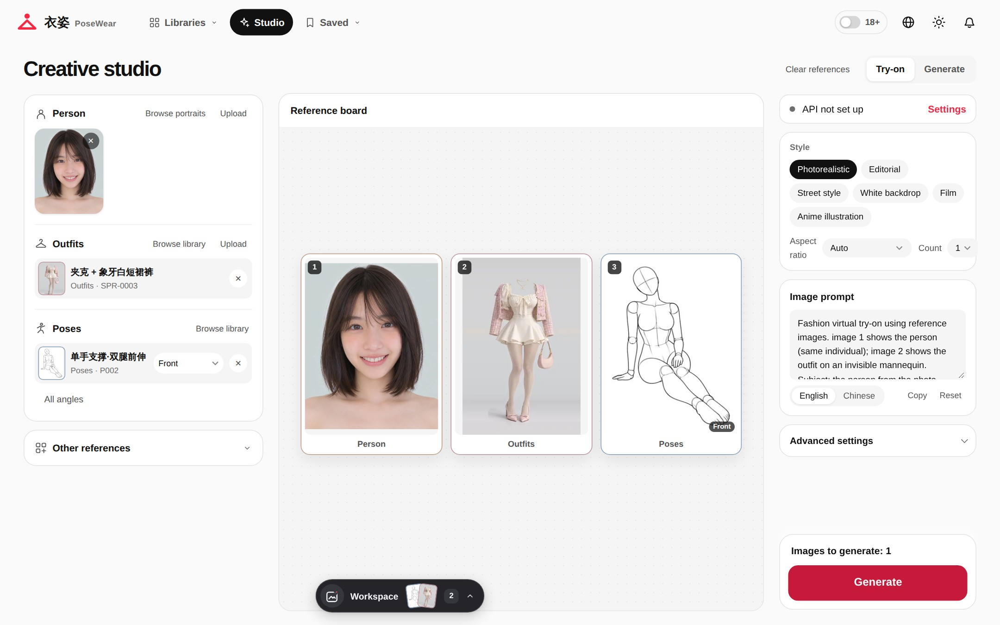
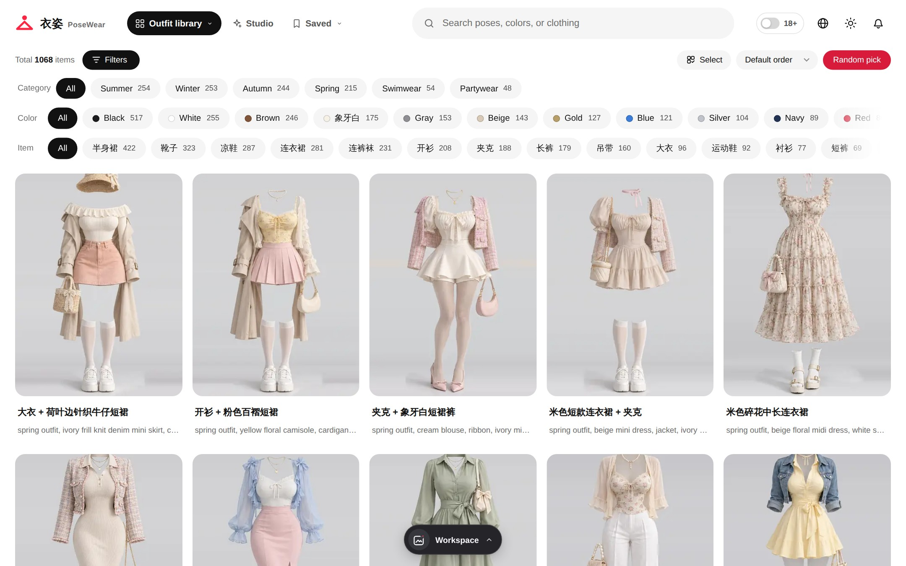
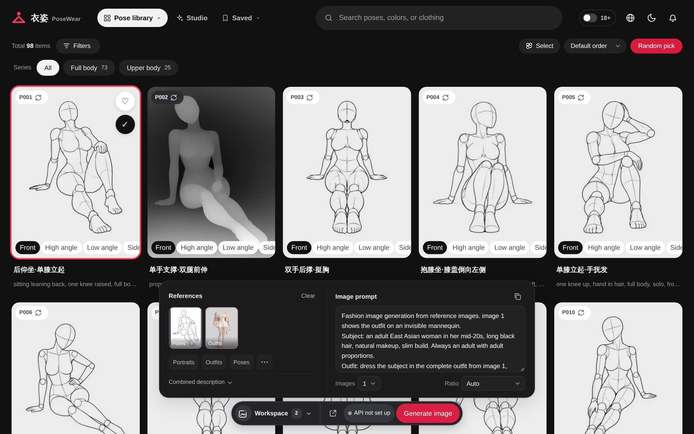

<div align="center">



<sub>The result is an AI-generated example using a portrait, pose and outfit from the galleries as references. Source images belong to their authors; see Sources and licenses below.</sub>


# PoseWear

A place to find reference images for drawing, photography, and AI generation.

Twelve libraries — poses, outfits, portraits, expressions, and more — each with Chinese and English prompts. Pick your references and generate right in the browser, or hand the set to your AI agent.

[](LICENSE)
[](https://pages.cloudflare.com/)
[](https://posewear.pages.dev)
[](https://github.com/atuizz/posewear/stargazers)

[Live site](https://posewear.pages.dev/) · [简体中文](README.md) · [日本語](README.ja.md) · [Tiếng Việt](README.vi.md) · [Changelog](CHANGELOG.md)

</div>

> [!CAUTION]
> **Beware of impostors**: official access is only via [posewear.pages.dev](https://posewear.pages.dev/) and this repository — free, with no accounts and no paid plans. PoseWear has no Windows or Android app, and is never distributed as an exe/apk through any file-sharing service. Sites such as posewear.cn and posewear.art claiming to be official, offering exe/apk downloads, or asking you to sign in or pay are impersonators — do not download, sign in, pay, or enter an API key there.

---

## Finding references

- **Poses come in pairs**: every pose has a line sketch and a depth map from the same camera angle. Flip between them on the card, or send both to generation together.
- **A floating workspace collects as you browse**: tap + on any card to drop it into the tray at the bottom. Generate from the tray, or copy the whole set — prompts plus public image links.
- **The full studio mixes freely**: a person, an outfit, poses, plus expressions, hair, scenes, lighting, props, and furniture. Use as many or as few as you like — a prompt alone works too. Upload your own photo to try outfits on.
- Everything you generate is kept under History, ready to view, download, or export as ZIP.



<table><tr>
<td width="33%"><br><sub>Twelve libraries, bilingual prompts</sub></td>
<td width="33%"><br><sub>Works on your phone, too</sub></td>
<td><br><sub>Dark mode, follows your system by default</sub></td>
</tr></table>

The interface speaks English, Chinese, Japanese, and Vietnamese; reference descriptions switch between Chinese and English.

---

## Three ways to generate

| Way | How it works |
| --- | --- |
| **Your own API key** | Use OpenAI, Gemini, or Seedream keys in the studio, or any endpoint compatible with the OpenAI, Gemini, or xAI image protocols. Requests go straight from your browser, or through the site proxy (relays may use http/https and any port). |
| **A model on your machine** | If you run ComfyUI or stable-diffusion.cpp, connect the local engine and generate without images leaving your computer. [Setup guide](docs/local-engines.md) |
| **Your AI agent** | The repo ships an MCP server so an agent can search references, fetch a specific angle, and assemble prompts with image links. [MCP guide](mcp/README.md) |

```sh
codex mcp add posewear -- node "$PWD/mcp/server.mjs"
```

Then just ask: “Find a side-view sitting pose with a spring outfit — give me the prompt and reference links.”

---

## Run it locally

Requires Node.js 22.12+:

```sh
git clone https://github.com/atuizz/posewear.git
cd posewear
npm ci
npm start
```

Open http://127.0.0.1:8787/ . Browsing, favorites, and copying need no account or key. Catalogs load from the public site on first open; images load on demand.

Favorites, settings, and API keys live only in your browser; generation history lives in the browser database. Clearing site data removes them.

---

## Development

Vanilla JS, a Python build, and Cloudflare Pages — no framework. Build, assets, tests, and deployment are documented in [AGENTS.md](AGENTS.md); `npm test` runs the regression suite.

Current release **v1.3.2** (2026-11-24): the impersonation notice now also names posewear.art; the official site is free, with no accounts and no paid plans. [All releases](CHANGELOG.md)

---

## Sources and licenses

Code, UI text, and build scripts are [MIT](LICENSE). Self-host, fork, package it as a client, even run it commercially — all fine. One condition: don’t use the PoseWear name and don’t pass yourself off as the official project; just credit the source. Note that image licenses are separate from the code license: some upstream galleries below don’t allow commercial use or redistribution, so clear rights with the original authors before any commercial use, at your own risk. Image sources:

| Material | Source |
| --- | --- |
| Poses, depth poses, outfits, anime outfits | ギア / @giaaibusi — ask the author before commercial use or redistribution. [Sketches](https://ai-pose-gallery.pages.dev/) · [Depth](https://ai-pose-depth-gallery.pages.dev/) · [Outfits](https://ai-costume-gallery.pages.dev/) · [Anime outfits](https://ai-costume-anime-gallery.pages.dev/) |
| Portraits | Fictional AI portraits by @agi_aibusi, CC0; the author asks that they not be reposted in bulk unchanged. [AI Portrait Gallery](https://ai-portrait-gallery.pages.dev/) |
| Hair and some anime outfits | たき AI / CharaDB, tags CC0, images load from the source site. [CharaDB](https://charadb-2fi.pages.dev/) |
| Expressions | WaveSpeed AI Emotion Gallery; head model ICT FaceKit (© USC Institute for Creative Technologies, MIT) |
| Historical dress, scenes, lighting, props, furniture | Shisei / wquguru, CC0 1.0 |

Inspired by [gen-ai-pose-image](https://github.com/wzc520pyfm/gen-ai-pose-image) and [nvzhuang](https://github.com/paipiange/nvzhuang) — thank you.
