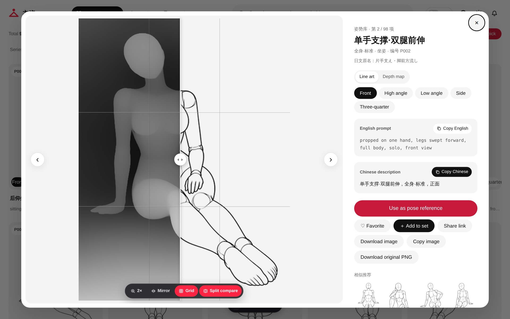

<div align="center">

<br>


# PoseWear

**Visual reference library & browser creative studio for drawing, photography, and AI image generation**

12 curated libraries · 5,700+ references · Bilingual Chinese & English prompts · Zero accounts, zero subscriptions.

[](https://posewear.pages.dev/)
[](#twelve-libraries-at-a-glance)
[](CHANGELOG.md)
[](LICENSE)
[](https://github.com/atuizz/posewear/stargazers)

**[Live Site](https://posewear.pages.dev/)** · [Highlights](#highlights) · [Libraries](#twelve-libraries-at-a-glance) · [Generation Modes](#three-ways-to-generate) · [Run Locally](#run-locally) · [简体中文](README.md) · [日本語](README.ja.md) · [Changelog](CHANGELOG.md)

<br>


<sub>Example generated from a PoseWear portrait, pose, and outfit. Source image rights belong to their respective creators; see Sources and licenses below.</sub>

</div>

> [!CAUTION]
> **Beware of impostors**: official access is only via [posewear.pages.dev](https://posewear.pages.dev/) and this repository — free, with no accounts and no paid plans. PoseWear has no Windows or Android app, and is never distributed as an exe/apk through any file-sharing service. Sites such as `posewear.cn` and `posewear.art` claiming to be official, offering exe/apk downloads, or asking you to sign in or pay are impersonators — do not download, sign in, pay, or enter an API key there.

---

## Highlights

### Artist Lightbox Studio · Live Line-Art × Depth Split Compare

<p align="center">
  
</p>

Every pose comes paired with a **line sketch** and a **matching depth map** from the exact same camera angle. Flip any card in place from its badge, or open the lightbox to inspect with built-in artist tools:

- **`Z` / Double-click**: 2× zoom with drag-to-pan for folds, hands, and perspective details
- **`H` Mirror**: instant horizontal flip to check balance and anatomical proportions
- **`G` Composition Grid**: cycle between rule-of-thirds and center-axis / quarter proportion guides
- **`B` Grayscale Value Study & Auto Color Palette**: toggle luminance grayscale for tonal study and extract up to 5 real `#HEX` swatches from color photos (one click to copy)
- **`V` Split Compare**: drag a live curtain between line art and depth map from the same angle

---

### Creative Studio · Numbered Reference Board & Try-On

<p align="center">
  
</p>

<table>
  <tr>
    <td width="33.3%" valign="top">
      <br>
      <b>Visual Color Swatches & Bilingual Prompts</b><br>
      <sub>Filter outfits by real color swatches; copying any card or set includes exact-angle public image links.</sub>
    </td>
    <td width="33.3%" valign="top">
      <br>
      <b>Dark Canvas & Floating Workspace</b><br>
      <sub>Collect references without leaving the gallery, edit prompts in the dock, and generate on the spot.</sub>
    </td>
    <td width="33.3%" valign="top">
      <br>
      <b>Built for Touch & Mobile</b><br>
      <sub>Flip poses, switch angles, assemble sets, and review history comfortably on a phone.</sub>
    </td>
  </tr>
</table>

<table>
  <tr>
    <td width="50%" valign="top">
      <b>Numbered Board & One-Click Moodboard PNG Export</b><br>
      Each card displays its send index (<code>1 / 2 / 3</code>) and camera angle matching <code>image 1 / 2 / 3</code> in the prompt. Shuffle looks, clear with Undo, and <b>export a high-resolution reference sheet PNG</b> ready for Midjourney, Kling, PureRef, or sharing.
    </td>
    <td width="50%" valign="top">
      <b>Fullscreen Gesture Drawing Studio</b><br>
      Launch a distraction-free timed practice session from your current filtered gallery—with <code>30s / 60s / 2m / 5m</code> timers, <code>5 / 10 / 20 / Endless</code> decks, optional chime, mirror / grid / grayscale / depth-flip tools, and a clickable session recap sheet.
    </td>
  </tr>
  <tr>
    <td width="50%" valign="top">
      <b>Local History with Reference Traceability</b><br>
      Generated outputs stay in your browser’s IndexedDB with mode filters (Try-on / Generate), prompt/model search, clickable thumbnails of the exact references used inside the lightbox, single downloads, and batch ZIP export.
    </td>
    <td width="50%" valign="top">
      <b>Global Command Palette (⌘K) & Fast Picker</b><br>
      Press <code>⌘K</code> / <code>Ctrl+K</code> anywhere to jump across all 12 libraries, search, launch Gesture Practice, or toggle themes & languages; the studio picker adds category chips, Favorites-only filtering, and drag-and-drop uploads.
    </td>
  </tr>
</table>

---

## Twelve Libraries at a Glance

| Group | Libraries | Items | Highlights |
| :--- | :--- | :---: | :--- |
| **Movement** | Poses · Depth poses | `288` × 2 | Paired line sketches and depth maps, multiple angles, in-place card flip & lightbox split compare |
| **People** | Portraits · Expressions · Hairstyles | `1,499` / `95` / `122` | CC0 fictional portraits, ICT-FaceKit expression intensity filters, multi-color hairstyle variants |
| **Wardrobe** | Outfits · Anime outfits · Historical dress | `1,407` / `1,760` / `57` | Visual color swatches & garment filters spanning contemporary, anime, and period outfits |
| **Setting** | Scenes · Lighting · Props · Furniture | `64` / `50` / `32` / `41` | Multi-angle environments, lighting setups, props, and furniture for full scene composition |

---

## Three Ways to Generate

| Mode | Best For | How It Works |
| :--- | :--- | :--- |
| **Cloud API Key** | Fastest setup & top multi-image models | Connect OpenAI, Gemini, Seedream, or any OpenAI / Gemini / xAI-compatible relay. Send directly from your browser or via the site proxy (`http`/`https` and any port supported for custom relays). |
| **Local Engine** | Full privacy & zero API cost | Connect **ComfyUI** or **stable-diffusion.cpp** (`sd-server`) running on your own machine—images never leave your device. Supports built-in single-ref and custom multi-ref ComfyUI API workflows. [Setup guide →](docs/local-engines.md) |
| **AI Agent (MCP)** | Automated reference hunting in Codex / Claude | Ships a read-only stdio MCP server and reference-picking skill so your agent can search all 12 libraries, pick exact angles, and assemble briefs with image links. [MCP guide →](mcp/README.md) |

```sh
# Connect the MCP server (Codex example)
codex mcp add posewear -- node "$PWD/mcp/server.mjs"
```

> Then just ask: “Find a side-view sitting pose with a spring outfit — give me the prompt and reference links.”

---

## Run Locally

Requires **Node.js 22.12+** — no bundler, no database:

```sh
git clone https://github.com/atuizz/posewear.git
cd posewear
npm ci
npm start
```

Open `http://127.0.0.1:8787/`. Browsing, favorites, and copying require no account or API key; catalogs load from the public site on first open and images load on demand.

- **No accounts**: zero sign-ups, zero server-side tracking
- **Browser-local state**: favorites, settings, and API keys stay in `localStorage`; history stays in IndexedDB
- **Clean removal**: clearing site data removes all local data immediately

<details>
<summary><b>Keyboard Shortcuts</b></summary>

| Key | Action |
| :---: | :--- |
| `⌘K` / `Ctrl+K` | Open global Command Palette (libraries, search, Gesture Studio, settings) |
| `/` | Focus search |
| `R` | Pick a random reference |
| `T` | Toggle light / dark theme (works in gallery & lightbox) |
| `L` | Switch reference description language (ZH / EN) |
| `1` – `9` | Jump across libraries |
| `←` `→` / `↑` `↓` | Lightbox: previous / next item, switch camera angle |
| `Z` / `H` / `G` / `B` / `V` | Lightbox: 2× zoom / mirror / composition grid / grayscale value check / split depth compare |
| `Space` | Gesture Studio: pause / resume timer |
| `F` / `A` / `C` / `S` | Lightbox: favorite / add to set / copy prompt / share link |
| `Esc` | Close lightbox, Gesture Studio, Command Palette, or dialog |

</details>

---

## Development & Tests

Pure static architecture: **vanilla JS + Python build + Cloudflare Pages** (no framework, no bundler). See [AGENTS.md](AGENTS.md) for asset setup, build steps, and deployment checks.

```sh
# Offline regression suite (works cleanly from source with no asset archive)
npm run test:offline

# Full site regression suite (against local preview or staging build)
npm test
```

Current release **v1.3.2** (2026-11-24) · [Full changelog](CHANGELOG.md)

---

## Sources and Licenses

Code, UI copy, and build scripts are licensed under [MIT](LICENSE). Self-hosting, forking, packaging as a client, or commercial operation are all allowed — **with one condition: do not use the PoseWear name, do not impersonate the official project, and credit the source**.

Image rights are separate from the code license: some upstream galleries below restrict commercial use or redistribution. Clear rights with the original creators before any commercial use, at your own risk.

| Libraries | Source & License |
| :--- | :--- |
| Poses, depth poses, outfits, anime outfits | ギア / [@giaaibusi](https://x.com/giaaibusi) — contact the creator before commercial use or redistribution. [Sketches](https://ai-pose-gallery.pages.dev/) · [Depth](https://ai-pose-depth-gallery.pages.dev/) · [Outfits](https://ai-costume-gallery.pages.dev/) · [Anime outfits](https://ai-costume-anime-gallery.pages.dev/) |
| Portraits | Fictional AI portraits by @agi_aibusi (CC0); please avoid bulk unmodified reposts. [AI Portrait Gallery](https://ai-portrait-gallery.pages.dev/) |
| Hairstyles & selected anime outfits | たき AI / CharaDB — tags CC0, images hotlinked from source. [CharaDB](https://charadb-2fi.pages.dev/) |
| Expressions | WaveSpeed AI Emotion Gallery; head model ICT-FaceKit (© USC Institute for Creative Technologies, MIT) |
| Historical dress, scenes, lighting, props, furniture | Shisei / wquguru (CC0 1.0) |

<div align="center">

<br>

<sub>Inspired by <a href="https://github.com/wzc520pyfm/gen-ai-pose-image">gen-ai-pose-image</a> and <a href="https://github.com/paipiange/nvzhuang">nvzhuang</a> — thank you.</sub>

</div>
