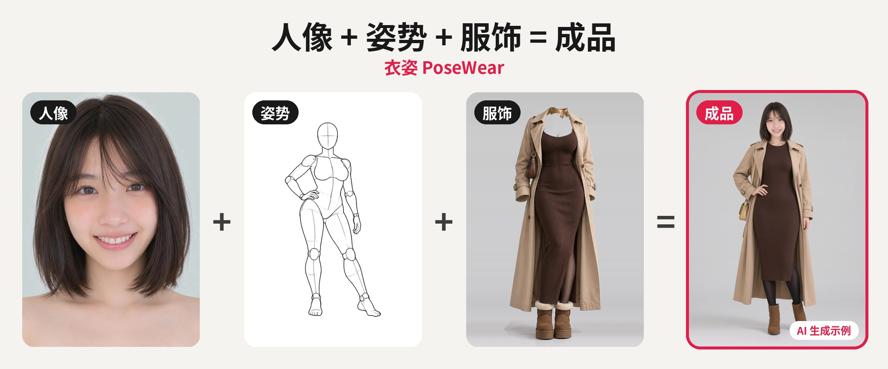
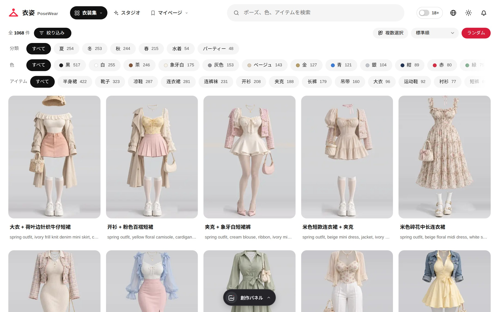

<div align="center">



<sub>成果物は、ギャラリーの人物・ポーズ・服装を参考に AI が生成した例です。素材画像の著作権は各作者に帰属します。下記の「素材の出典とライセンス」を参照してください。</sub>


# 衣姿 PoseWear

絵を描くとき、写真を撮るとき、AI で画像を作るときの参考素材を探す場所。

ポーズ・衣装・人物・表情など 12 の素材集に、中英プロンプト付き。素材を選べばそのままブラウザで生成でき、組み合わせを AI エージェントに渡すこともできます。

[](LICENSE)
[](https://pages.cloudflare.com/)
[](https://posewear.pages.dev)
[](https://github.com/atuizz/posewear/stargazers)

[オンライン版](https://posewear.pages.dev/) · [简体中文](README.md) · [English](README.en.md) · [Tiếng Việt](README.vi.md) · [更新履歴](CHANGELOG.md)

</div>

> [!CAUTION]
> **偽サイトにご注意**：公式の入口は [posewear.pages.dev](https://posewear.pages.dev/) と本リポジトリのみです。無料で、アカウント登録も有料プランもありません。PoseWear に Windows / Android アプリはなく、ネットドライブ等でインストールパッケージを配布することもありません。posewear.cn や posewear.art など公式を名乗り、exe / apk のダウンロード提供やログイン・支払いを求めるサイトはすべて偽物です。ダウンロード、ログイン、支払いをせず、API キーを入力しないでください。

---

## 素材の探し方

- **ポーズは線画と深度画像のペア**：同じポーズ・同じアングルの両面がそろっています。カードの番号を押すと裏返り、両方を生成に使うこともできます。
- **フローティング作業台で集める**：閲覧しながらカードの ＋ を押すだけで下部の作業台に入ります。そこから生成したり、プロンプトと画像リンクをまとめてコピーしたりできます。
- **本格スタジオでは自由に組み合わせ**：人物・衣装・ポーズに、表情・髪型・背景・照明・小道具・家具を加えて。使う素材は1つでも、プロンプトだけでも大丈夫です。自分の写真をアップロードすれば試着の比較もできます。
- 生成した画像は「生成履歴」に保存され、表示・ダウンロード・ZIP 書き出しができます。


<table><tr>
<td width="33%"><br><sub>12 の素材集、中英プロンプト付き</sub></td>
<td width="33%"><br><sub>スマホでも素材探し</sub></td>
<td><br><sub>ダークモード（初期設定はシステム連動）</sub></td>
</tr></table>

画面は日本語・中国語・英語・ベトナム語の4言語対応。素材の説明は中国語と英語を切り替えられます。

---

## 生成方法は3つから

| 方法 | 内容 |
| --- | --- |
| **自分の API キーで** | OpenAI、Gemini、豆包 Seedream のキー、または OpenAI / Gemini / xAI 互換の中継サービスをスタジオに設定。ブラウザから直接送るか、このサイトのプロキシ経由（http/https・任意ポート対応）で送れます。 |
| **この端末のモデルで** | ComfyUI や stable-diffusion.cpp を動かしているなら、ローカルエンジンに接続して生成できます。画像が端末の外に出ることはありません。[設定ガイド](docs/local-engines.md) |
| **AI エージェントに任せる** | リポジトリには MCP サーバーが入っていて、エージェントが素材検索、角度指定の取得、プロンプトと参照リンクの組み立てを自分で行えます。[MCP ガイド](mcp/README.md) |

```sh
codex mcp add posewear -- node "$PWD/mcp/server.mjs"
```

あとは「横向きの座りポーズに春服を合わせて、プロンプトと参考リンクをちょうだい」と頼むだけです。

---

## ローカルで動かす

Node.js 22.12 以上が必要です：

```sh
git clone https://github.com/atuizz/posewear.git
cd posewear
npm ci
npm start
```

http://127.0.0.1:8787/ を開いてください。閲覧・お気に入り・コピーにアカウントやキーは不要です。素材目録は初回にオンラインから読み込み、画像は必要なときに読み込みます。

お気に入り・設定・API キーはお使いのブラウザ内にだけ保存され、生成履歴もブラウザのデータベースに保存されます。サイトデータを消せば一緒に消えます。

---

## 開発

素の JS と Python ビルド、Cloudflare Pages のみで、フレームワークは使っていません。ビルド・素材準備・テスト・デプロイの手順は [AGENTS.md](AGENTS.md) にまとめています。回帰テストは `npm test` です。

現在のバージョンは **v1.3.2**（2026-11-24）：偽サイト声明に posewear.art を追加。公式サイトは無料で、アカウントも有料プランもありません。[全バージョン履歴](CHANGELOG.md)

---

## 素材の出典とライセンス

コード・画面文案・ビルドスクリプトは [MIT](LICENSE) です。自前公開、二次開発、クライアント化、有料運営も自由です。条件は一つだけ：PoseWear の名前を使わず、公式を名乗らないこと。出典の明記はお願いします。なお画像のライセンスはコードとは別で、下表の上流ギャラリーには商用・再配布不可のものが含まれます。商用前に各作者へ確認してください（責任は利用者側）。画像の出典は以下の通りです：

| 素材 | 出典 |
| --- | --- |
| ポーズ、深度ポーズ、衣装、アニメ衣装 | ギア / @giaaibusi。商用・転載は作者に確認してください。[線画](https://ai-pose-gallery.pages.dev/) · [深度](https://ai-pose-depth-gallery.pages.dev/) · [衣装](https://ai-costume-gallery.pages.dev/) · [アニメ衣装](https://ai-costume-anime-gallery.pages.dev/) |
| 人物 | @agi_aibusi の架空 AI 人物、CC0。作者はそのままの一括転載を控えるよう求めています。[AI Portrait Gallery](https://ai-portrait-gallery.pages.dev/) |
| 髪型と一部のアニメ衣装 | たき AI / CharaDB。タグは CC0、画像は元サイトから読み込みます。[CharaDB](https://charadb-2fi.pages.dev/) |
| 表情 | WaveSpeed AI Emotion Gallery。頭部モデルは ICT FaceKit（© USC Institute for Creative Technologies、MIT） |
| 時代衣装、背景、照明、小道具、家具 | Shisei / wquguru、CC0 1.0 |

インスピレーションをくれた [gen-ai-pose-image](https://github.com/wzc520pyfm/gen-ai-pose-image) と [nvzhuang](https://github.com/paipiange/nvzhuang) に感謝します。
