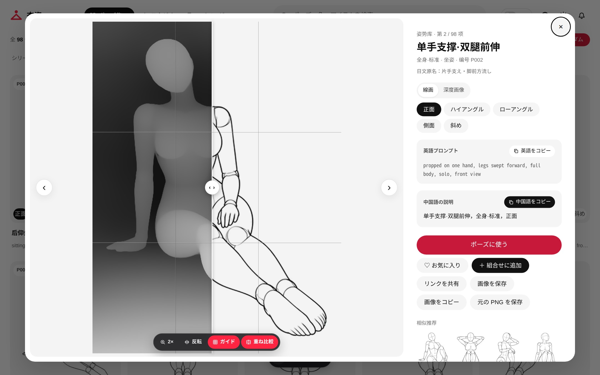
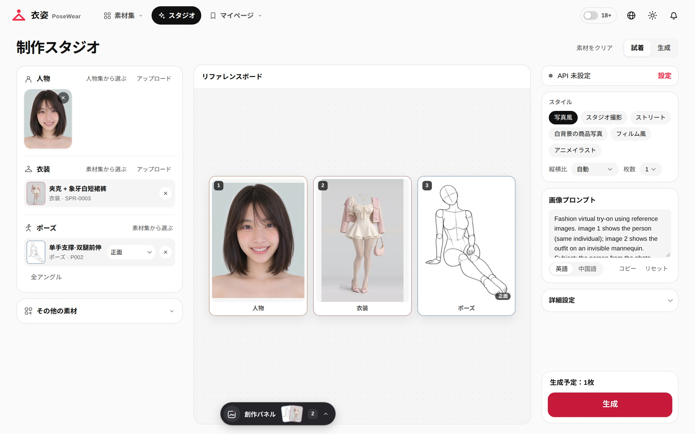
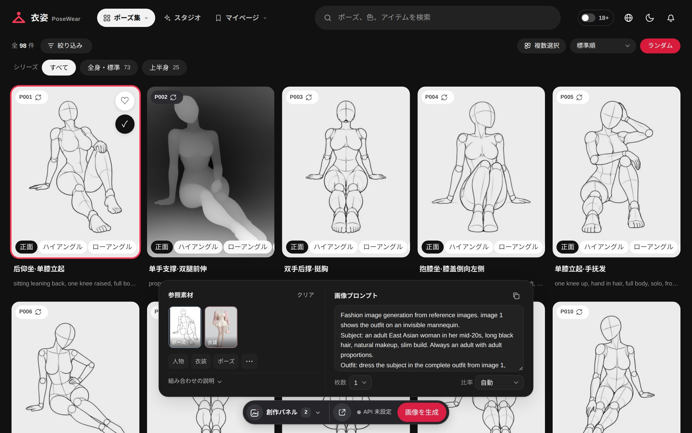

<div align="center">

<br>


# 衣姿 PoseWear

**イラスト・写真・AI 画像生成のためのビジュアルリファレンス集＆ブラウザ創作スタジオ**

12 の厳選素材集 · 5,700 件以上の参考素材 · 中英バイリンガルプロンプト · アカウント不要・完全無料。

[](https://posewear.pages.dev/)
[](#12-の素材集一覧)
[](CHANGELOG.md)
[](LICENSE)
[](https://github.com/atuizz/posewear/stargazers)

**[オンライン版](https://posewear.pages.dev/)** · [主な特徴](#主な特徴) · [素材集一覧](#12-の素材集一覧) · [生成方法](#選べる-3-つの生成方法) · [ローカル起動](#ローカルで動かす) · [简体中文](README.md) · [English](README.en.md) · [Tiếng Việt](README.vi.md) · [更新履歴](CHANGELOG.md)

<br>


<sub>上記はギャラリーの人物・ポーズ・服装を参照して AI が生成した例です。元画像の権利は各作者に帰属します（下記の「素材の出典とライセンス」を参照）。</sub>

</div>

> [!CAUTION]
> **偽サイトにご注意**：公式の入口は [posewear.pages.dev](https://posewear.pages.dev/) と本リポジトリのみです。無料で、アカウント登録も有料プランもありません。PoseWear に Windows / Android アプリはなく、ネットドライブ等でインストールパッケージを配布することもありません。`posewear.cn` や `posewear.art` など公式を名乗り、exe / apk のダウンロード提供やログイン・支払いを求めるサイトはすべて偽物です。ダウンロード、ログイン、支払いをせず、API キーを入力しないでください。

---

## 主な特徴

### 作画向けプレビュービューア · 線画 × 深度マップのリアルタイム重ね比較

<p align="center">
  
</p>

すべてのポーズに同じ動き・同じアングルの**線画**と**深度マップ**が対で用意されています。カードの番号からその場で裏返せるほか、拡大プレビュー下部のフロートツールバーで作画チェックに役立つ機能が使えます：

- **`Z` / ダブルクリック**：2× 拡大＆ドラッグ移動でしわ・手先・パースの細部を確認
- **`H` 左右反転**：ワンキーで水平反転し、重心やプロポーションのバランスを検証
- **`G` 構図ガイド**：三分割グリッドと中央赤軸＋四分割ラインを切り替え
- **`B` グレースケール明度確認＆自動カラーパレット**：ワンキーで白黒明度をチェック。カラー写真からは主要 5 色の `#HEX` を自動抽出し、クリックで即コピー
- **`V` 重ね比較**：同アングルの線画と深度マップをスライダーでリアルタイム比較

---

### 創作スタジオ · 送信番号付きリファレンスボード＆バーチャル試着

<p align="center">
  
</p>

<table>
  <tr>
    <td width="33.3%" valign="top">
      <br>
      <b>カラースウォッチ絞り込み × 中英プロンプト</b><br>
      <sub>衣装ライブラリは実際の色ドットで直感的に検索可能。コピー時に指定アングルの公開リンクも自動添付。</sub>
    </td>
    <td width="33.3%" valign="top">
      <br>
      <b>ダークキャンバス × 創作パネル</b><br>
      <sub>閲覧を止めずに素材を集め、下部パネルからプロンプト調整と生成までそのまま完結。</sub>
    </td>
    <td width="33.3%" valign="top">
      <br>
      <b>モバイル・タッチ操作対応</b><br>
      <sub>スマホでもカード反転、アングル切替、素材選択、履歴確認が快適に行えます。</sub>
    </td>
  </tr>
</table>

<table>
  <tr>
    <td width="50%" valign="top">
      <b>番号付きボード＆リファレンス PNG 書き出し</b><br>
      ボード上の各カードに送信番号（<code>1 / 2 / 3</code>）とアングルを表示し、プロンプト内の <code>image 1 / 2 / 3</code> と対応づけ。シャッフルや一括クリア（元に戻す）に加え、<b>高解像度ムードボード PNG の書き出し</b>にも対応しています。
    </td>
    <td width="50%" valign="top">
      <b>全画面クロッキー練習（タイマー自動切替）</b><br>
      絞り込み中の素材集からそのまま集中練習へ。<code>30s / 60s / 2m / 5m</code> タイマー、<code>5 / 10 / 20 / 無制限</code> 枚数、チャイム音、左右反転・ガイド・明度・深度切替、終了後の振り返り一覧まで完結。
    </td>
  </tr>
  <tr>
    <td width="50%" valign="top">
      <b>参照元を辿れるローカル生成履歴</b><br>
      生成画像はブラウザ内 IndexedDB に保存。モード別（試着／生成）絞り込み、プロンプト・モデル名検索、プレビュー内での使用済み参考画像サムネイル表示、単体保存・ZIP 一括書き出しに対応。
    </td>
    <td width="50%" valign="top">
      <b>コマンドパレット（⌘K）＆高速ピッカー</b><br>
      どこからでも <code>⌘K</code> / <code>Ctrl+K</code> で 12 素材集の移動・検索・クロッキー開始・外観切替を即時実行。素材選択モーダルはカテゴリ絞り込み、「お気に入りのみ」、ドラッグアップロードに対応。
    </td>
  </tr>
</table>

---

## 12 の素材集一覧

| グループ | 素材集 | 収録数 | 特徴 |
| :--- | :--- | :---: | :--- |
| **動作** | ポーズ · 深度ポーズ | `288` × 2 | 同ポーズ・同アングルの線画＋深度ペア、カード反転＆プレビュー重ね比較 |
| **人物・髪型** | 人物 · 表情 · 髪型 | `1,499` / `95` / `122` | CC0 架空ポートレート、ICT-FaceKit 感情強度分類、複数髪色バリエーション |
| **衣類** | 衣装 · アニメ衣装 · 時代衣装 | `1,407` / `1,760` / `57` | 色スウォッチ＆アイテム絞り込み対応。普段着からアニメ・歴史衣装まで網羅 |
| **空間・小物** | 背景 · 照明 · 小道具 · 家具 | `64` / `50` / `32` / `41` | 複数アングル対応。背景・ライティング・持ち物や家具で場面全体を構成 |

---

## 選べる 3 つの生成方法

| 方法 | 向いている用途 | 仕組み |
| :--- | :--- | :--- |
| **自分の API キー** | すぐ始めたい・高性能モデルを使いたい | OpenAI・Gemini・豆包 Seedream や OpenAI / Gemini / xAI 互換中継を設定。ブラウザ直結またはサイトプロキシ経由に対応（カスタム中継は `http`/`https`・任意ポート対応）。 |
| **ローカルエンジン** | プライバシー重視・API 費用ゼロ | PC 上の **ComfyUI** または **stable-diffusion.cpp**（`sd-server`）に接続し、画像を端末外に出さずに生成。カスタム多画像 ComfyUI ワークフローにも対応。[設定ガイド →](docs/local-engines.md) |
| **AI エージェント（MCP）** | Codex / Claude 等に素材探しを任せる | 読み取り専用 stdio MCP サーバーと選図スキルを同梱。12 素材集の検索、アングル指定取得、画像リンク付きプロンプト生成を自動化。[MCP ガイド →](mcp/README.md) |

```sh
# ローカル MCP の登録例（Codex）
codex mcp add posewear -- node "$PWD/mcp/server.mjs"
```

> 登録後は「横向きの座りポーズに春服を合わせて、プロンプトと参考リンクをちょうだい」と頼むだけです。

---

## ローカルで動かす

**Node.js 22.12 以上** が必要です（バンドラー・DB 不要）：

```sh
git clone https://github.com/atuizz/posewear.git
cd posewear
npm ci
npm start
```

起動後 `http://127.0.0.1:8787/` を開きます。閲覧・お気に入り・コピーにアカウントや API キーは不要です。初回起動時に公開目録を読み込み、画像は必要に応じて取得します。

- **アカウント不要**：登録・ログイン・サーバー側追跡なし
- **端末内のみ保存**：お気に入り・設定・API キーは `localStorage`、生成履歴は IndexedDB に保存
- **完全消去**：ブラウザのサイトデータを削除すればすべて消えます

<details>
<summary><b>キーボードショートカット一覧</b></summary>

| キー | 操作 |
| :---: | :--- |
| `⌘K` / `Ctrl+K` | グローバルコマンドパレットを開く（素材集移動・検索・クロッキー開始） |
| `/` | 検索欄にフォーカス |
| `R` | ランダムに 1 件開く |
| `T` | ライト／ダーク切替（一覧・プレビュー両対応） |
| `L` | 素材説明言語の切替（中国語／英語） |
| `1` – `9` | ライブラリの切替 |
| `←` `→` / `↑` `↓` | プレビュー：前後の項目・アングル切替 |
| `Z` / `H` / `G` / `B` / `V` | プレビュー：2× 拡大 / 左右反転 / 構図ガイド / グレースケール明度 / 線画・深度重ね比較 |
| `Space` | クロッキー練習：タイマーの一時停止・再開 |
| `F` / `A` / `C` / `S` | プレビュー：お気に入り / 組合せ追加 / 説明コピー / 共有リンク |
| `Esc` | プレビュー・クロッキー・コマンドパレット・ダイアログを閉じる |

</details>

---

## 開発・テスト

フレームワークなしの純静的構成：**素の JS + Python ビルド + Cloudflare Pages**。ビルド・素材管理・デプロイ手順は [AGENTS.md](AGENTS.md) を参照してください。

```sh
# オフライン回帰テスト（素材アーカイブ不要）
npm run test:offline

# 全サイト回帰テスト（ローカルプレビューまたは staging 向け）
npm test
```

現在のリリース：**v1.4.0**（2026-11-25）· [全バージョン履歴](CHANGELOG.md)

---

## 素材の出典とライセンス

コード・画面文案・ビルドスクリプトは [MIT](LICENSE) ライセンスです。自前公開、二次開発、クライアント化、商用運営も自由ですが、**PoseWear の名前を使わず公式を名乗らないこと・出典を明記すること**を条件とします。

画像のライセンスはコードとは別です。下表の上流ギャラリーには商用利用・再配布を制限するものが含まれるため、商用利用の前に必ず各原作者へご確認ください（責任は利用者側に帰属します）。

| 素材集 | 出典・ライセンス |
| :--- | :--- |
| ポーズ、深度ポーズ、衣装、アニメ衣装 | ギア / [@giaaibusi](https://x.com/giaaibusi) — 商用・転載前に原作者へ確認してください。[線画](https://ai-pose-gallery.pages.dev/) · [深度](https://ai-pose-depth-gallery.pages.dev/) · [衣装](https://ai-costume-gallery.pages.dev/) · [アニメ衣装](https://ai-costume-anime-gallery.pages.dev/) |
| 人物 | @agi_aibusi の架空 AI 人物（CC0）。そのままの一括転載は控えてください。[AI Portrait Gallery](https://ai-portrait-gallery.pages.dev/) |
| 髪型と一部のアニメ衣装 | たき AI / CharaDB — タグ CC0、画像は元サイトから読み込み。[CharaDB](https://charadb-2fi.pages.dev/) |
| 表情 | WaveSpeed AI Emotion Gallery；頭部モデルは ICT-FaceKit（© USC Institute for Creative Technologies、MIT） |
| 時代衣装、背景、照明、小道具、家具 | Shisei / wquguru（CC0 1.0） |

<div align="center">

<br>

<sub>インスピレーションをくれた <a href="https://github.com/wzc520pyfm/gen-ai-pose-image">gen-ai-pose-image</a> と <a href="https://github.com/paipiange/nvzhuang">nvzhuang</a> に感謝します。</sub>

</div>
