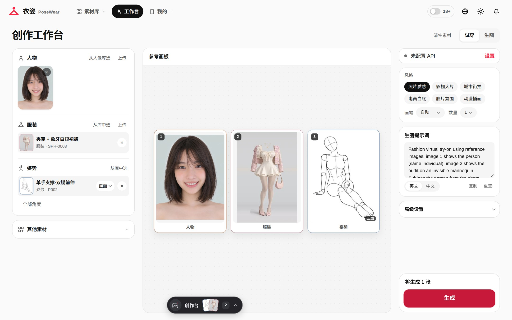
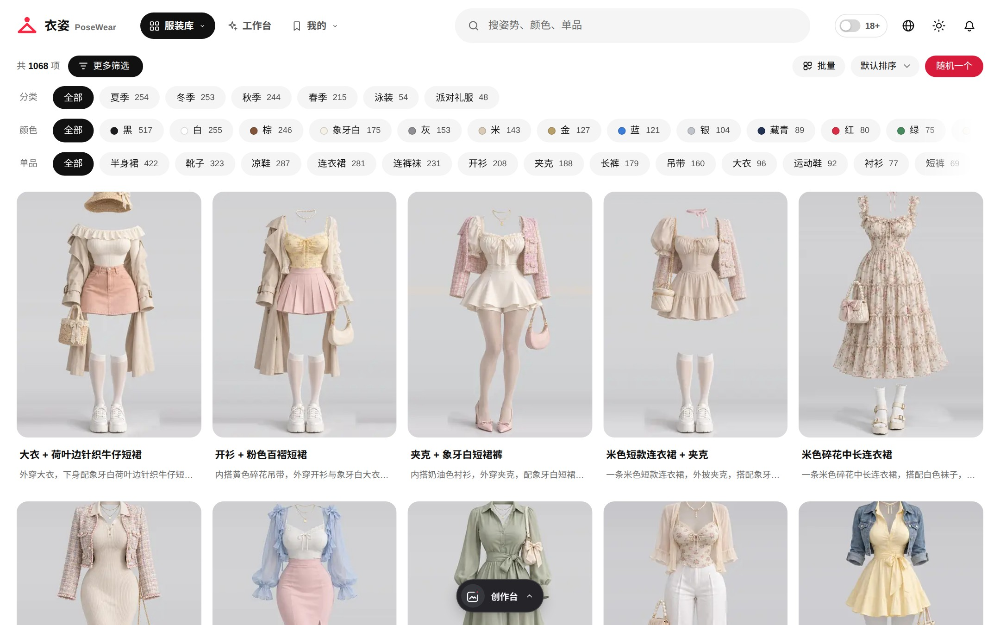
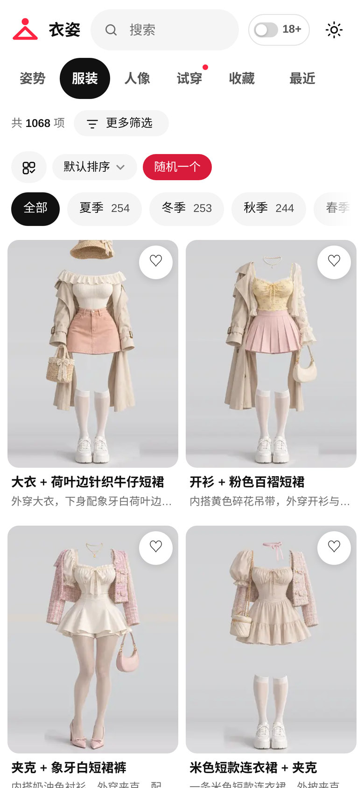

<div align="center">


<sub>成品为用站内人像、姿势、服装作参考的 AI 生成示例；素材版权归原作者，见下文「素材来源与许可」。</sub>


# 衣姿 PoseWear

给绘画、摄影和 AI 生图挑参考图的地方。

姿势、服装、人像、表情等 12 个图库，配中英文提示词；选好素材就能在站内拼图生图，也可以把组合交给你的 AI 智能体。

[](LICENSE)
[](https://pages.cloudflare.com/)
[](https://posewear.pages.dev)
[](https://github.com/atuizz/posewear/stargazers)

[在线图库](https://posewear.pages.dev/) · [English](README.en.md) · [日本語](README.ja.md) · [Tiếng Việt](README.vi.md) · [更新日志](CHANGELOG.md)

</div>

> [!CAUTION]
> **谨防冒充**：官方入口只有 [posewear.pages.dev](https://posewear.pages.dev/) 和本仓库，免费、无需注册账号、没有收费套餐。PoseWear 没有 Windows / Android 客户端，也不在任何网盘分发安装包；以 posewear.cn、posewear.art 等域名冒充官网、提供 exe / apk 下载或要求登录付费的均为假冒，请勿下载、登录或付款，更不要在其中填写 API Key。

---

## 挑图

- **姿势和深度图是成对的**：同一动作、同一机位，一面线稿一面深度图，在卡片上点编号就能翻面，两面可以一起拿去生图。
- **悬浮工作台随手攒素材**：浏览时点卡片上的 ＋ 就收进底部工作台，不用离开图库；攒够了直接生图，或者把整组提示词和图片直链复制走。
- **完整工作台自由拼**：人物、服装、姿势，加上表情、发型、场景、光影、道具、家具，想用几样用几样，只写提示词也行。上传自己的照片可以试穿对比。
- 生成过的图都存在「生成记录」里，能回看、下载、打包。



<table><tr>
<td width="33%"><br><sub>12 个图库，中英文提示词</sub></td>
<td width="33%"><br><sub>手机上也能选图</sub></td>
<td><br><sub>深色模式，默认跟随系统</sub></td>
</tr></table>

界面有中文、英文、日文三语，素材描述可在中英文之间切换。

---

## 生图走哪条路，随你

| 方式 | 怎么回事 |
| --- | --- |
| **云端 API Key** | 在工作台里填 OpenAI、Gemini、豆包 Seedream 的密钥，或任何兼容 OpenAI / Gemini / xAI 协议的中转。浏览器直连，或经本站代理转发（中转支持 http/https 和任意端口）。 |
| **本机引擎** | 装了 ComfyUI 或 stable-diffusion.cpp 的话，连本机引擎生图，图片不出这台电脑。[配置说明](docs/local-engines.md) |
| **MCP 智能体** | 仓库带一个 MCP 服务，智能体能自己搜素材、按角度取图、拼好提示词和参考图链接。[MCP 说明](mcp/README.md) |

```sh
codex mcp add posewear -- node "$PWD/mcp/server.mjs"
```

接好之后直接跟它说：「找一个侧面的坐姿，配一套春装，给我提示词和参考图。」

---

## 本地跑起来

需要 Node.js 22.12+：

```sh
git clone https://github.com/atuizz/posewear.git
cd posewear
npm ci
npm start
```

打开 http://127.0.0.1:8787/ 。浏览、收藏、复制都不需要账号和密钥；素材目录首次打开时联网载入，图片按需加载。

收藏、设置和 API Key 只存在你自己的浏览器里，生成记录存在浏览器数据库里，清站点数据即删。

---

## 开发

原生 JS + Python 构建 + Cloudflare Pages，没有框架。构建、素材准备、测试和部署流程都在 [AGENTS.md](AGENTS.md) 里，`npm test` 跑回归。

当前版本 **v1.3.2**（2026-11-24）：冒充声明扩围，新增 posewear.art；官方站免费、无账号、无收费套餐。[全部版本记录](CHANGELOG.md)

---

## 素材来源与许可

代码、界面文案和构建脚本是 [MIT](LICENSE)。自部署、二次开发、打包成客户端、收费运营都随意，只一条：不要顶着 PoseWear 的名字、不要冒充官方，注明来源即可。另请注意：图片素材的授权与代码无关，下表中部分上游图库不允许商用或再分发，商用前请自行向原作者确认，后果自负。图片各有出处如下：

| 素材 | 来源 |
| --- | --- |
| 姿势、深度姿势、服装、动画服装 | ギア / @giaaibusi，商用与转载请向作者确认。[线稿](https://ai-pose-gallery.pages.dev/) · [深度图](https://ai-pose-depth-gallery.pages.dev/) · [服装](https://ai-costume-gallery.pages.dev/) · [动画服装](https://ai-costume-anime-gallery.pages.dev/) |
| 人像 | @agi_aibusi 的虚构 AI 人像，CC0；作者希望不要原样批量转载。[AI Portrait Gallery](https://ai-portrait-gallery.pages.dev/) |
| 发型与部分动画服装 | たき AI / CharaDB，标签 CC0，图片在原站加载。[CharaDB](https://charadb-2fi.pages.dev/) |
| 表情 | WaveSpeed AI Emotion Gallery；头模为 ICT FaceKit（© USC Institute for Creative Technologies，MIT） |
| 历代服饰、场景、光影、道具、家具 | Shisei / wquguru，CC0 1.0 |

灵感来自 [gen-ai-pose-image](https://github.com/wzc520pyfm/gen-ai-pose-image) 与 [nvzhuang](https://github.com/paipiange/nvzhuang)，谢谢。
