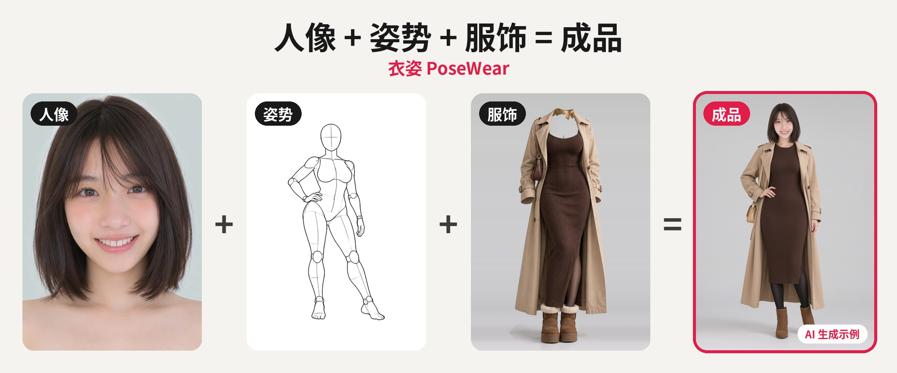
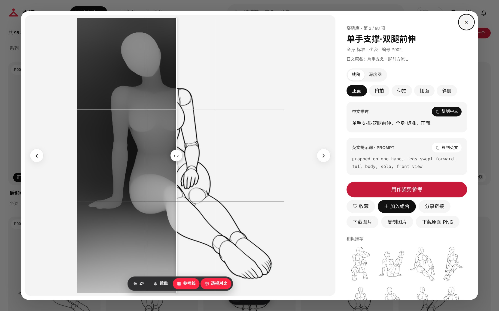
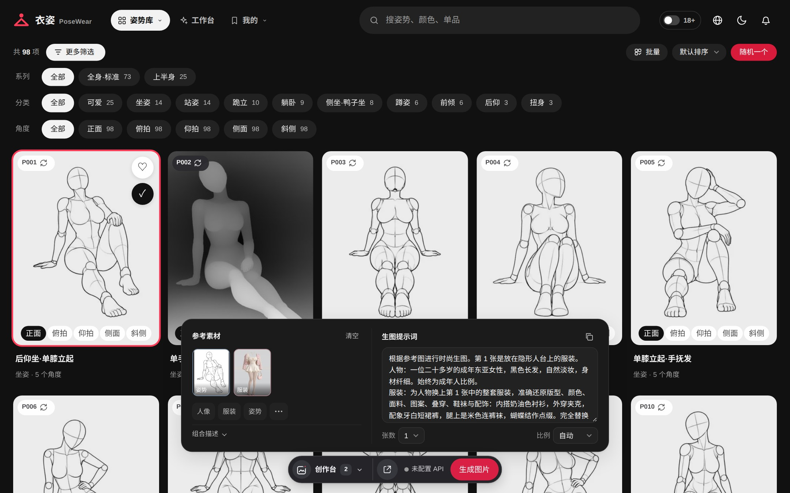

<div align="center">

<br>


# 衣姿 PoseWear

**给绘画、摄影与 AI 生图准备的视觉参考库与浏览器创作台**

12 个精选图库 · 5,700+ 条参考素材 · 中英双语提示词 · 打开即用，零账号、零订阅。

[](https://posewear.pages.dev/)
[](#12-个素材库一览)
[](CHANGELOG.md)
[](LICENSE)
[](https://github.com/atuizz/posewear/stargazers)

**[在线体验](https://posewear.pages.dev/)** · [核心亮点](#核心亮点) · [素材库一览](#12-个素材库一览) · [生图方式](#三种生图方式) · [本地运行](#本地运行) · [English](README.en.md) · [日本語](README.ja.md) · [Tiếng Việt](README.vi.md) · [Türkçe](README.tr.md) · [更新日志](CHANGELOG.md)

<br>



<sub>上图为使用站内人像、姿势、服装作参考的 AI 生成示例；素材版权归原作者，详见文末「素材来源与许可」。</sub>

</div>

> [!CAUTION]
> **谨防冒充**：官方入口只有 [posewear.pages.dev](https://posewear.pages.dev/) 和本仓库，免费、无需注册账号、没有收费套餐。PoseWear 没有 Windows / Android 客户端，也不在任何网盘分发安装包；以 `posewear.cn`、`posewear.art` 等域名冒充官网、提供 exe / apk 下载或要求登录付费的均为假冒，请勿下载、登录或付款，更不要在其中填写 API Key。

---

## 核心亮点

### 画师级参考检视台 · 线稿 × 深度图实时卷帘对比

<p align="center">
  
</p>

每一套姿势都配有同动作、同机位的**线稿**与**深度图**。在卡片上点编号即可原地翻面；点开大图后，底部浮动检视工具栏内置绘画常用核查工具：

- **`Z` / 双击画面**：2× 细节缩放并自由拖拽查看衣纹、手势与关节透视
- **`H` 镜像翻转**：一键水平镜像，核对人体重心与左右对称
- **`G` 构图参考线**：在三分构图线、中心红轴与四分比例线之间循环切换
- **`B` 灰度明度检查 & 自动取色板**：一键切灰度核对黑白素描明度关系，彩色参考图自动提取 5 枚实拍主色 `#HEX`（点击即复制）
- **`V` 透视对比**：线稿与深度图同视角实时卷帘叠加，立体体积一目了然

---

### 自由混搭创作工作台 · 序号画板与一键试穿

<p align="center">
  
</p>

<table>
  <tr>
    <td width="33.3%" valign="top">
      <br>
      <b>色卡快筛 × 双语提示词</b><br>
      <sub>服装与动画服装支持色卡视觉快筛；单条与组合复制自动附带精确视角直链。</sub>
    </td>
    <td width="33.3%" valign="top">
      <br>
      <b>深色画布 × 悬浮创作台</b><br>
      <sub>随逛随加不打断浏览，在底部浮层里直接编辑提示词、选比例并出图。</sub>
    </td>
    <td width="33.3%" valign="top">
      <br>
      <b>移动端原生适配</b><br>
      <sub>触屏翻面、切视角、选材、生成与查看历史记录在手机上同样顺手。</sub>
    </td>
  </tr>
</table>

<table>
  <tr>
    <td width="50%" valign="top">
      <b>画板序号对齐提示词 · 一键导出拼图 PNG</b><br>
      参考画板为每张参考图标注发送序号（<code>1 / 2 / 3</code>）与当前机位，与提示词中的 <code>image 1 / 2 / 3</code> 一一对应；支持「换一组」抽卡、一键清空并撤销，还可直接<b>导出高分参考拼图 PNG</b>，方便发给 Midjourney / Kling / PureRef 或与团队分享。
    </td>
    <td width="50%" valign="top">
      <b>全屏速写定时练习（Gesture Studio）</b><br>
      基于当前筛选结果进入无干扰全屏定时练习，支持 <code>30s / 60s / 2m / 5m</code> 计时与 <code>5 / 10 / 20 / 无限</code> 张数、可选柔和提示音、镜像 / 参考线 / 灰度 / 线稿深度切换，结束后自动生成可点击回溯的练习回顾接触表。
    </td>
  </tr>
  <tr>
    <td width="50%" valign="top">
      <b>本地生成记录与参考溯源</b><br>
      所有成图存在本机浏览器 IndexedDB，支持按模式（试穿 / 生图）筛选与关键词搜索提示词/模型，大图侧栏自动列出本次所用的全部参考图并可点击回溯原条目，支持单张下载与批量 ZIP 打包。
    </td>
    <td width="50%" valign="top">
      <b>全局命令面板（⌘K）× 快捷选择器</b><br>
      任意页面按 <code>⌘K</code> / <code>Ctrl+K</code> 模糊检索并直达 12 个图库、工作台、速写计时器与外观/语言切换；工作台选择器支持分类快筛、「仅看收藏」与拖拽上传人物/服装图。
    </td>
  </tr>
</table>

---

## 12 个素材库一览

| 分组 | 素材库 | 规模 | 特点 |
| :--- | :--- | :---: | :--- |
| **姿态** | 姿势 · 深度姿势 | `288` × 2 | 同动作同机位成对联动，多拍摄角度，支持卡片原地翻面与灯箱卷帘对比 |
| **人物造型** | 人像 · 表情 · 发型 | `1,499` / `95` / `122` | CC0 虚构人像脸模、ICT-FaceKit 情绪强度分级、多发色变体热链参考 |
| **服饰** | 服装 · 动画服装 · 历代服饰 | `1,407` / `1,760` / `57` | 支持真实色卡与单品筛选，覆盖日常穿搭、动画造型与历代传统服饰 |
| **环境与物件** | 场景 · 光影 · 道具 · 家具 | `64` / `50` / `32` / `41` | 机位/视角可选，补全构图背景、布光氛围与手持/陈设细节 |

---

## 三种生图方式

| 方式 | 适用场景 | 说明 |
| :--- | :--- | :--- |
| **云端 API Key** | 开箱即用，支持最强多图编辑模型 | 填 OpenAI、Gemini、豆包 Seedream 密钥，或任意兼容 OpenAI / Gemini / xAI 协议的中转。支持浏览器直连或本站代理转发，自定义中转支持 `http` / `https` 与任意端口。 |
| **本机引擎** | 隐私优先、零 API 费用 | 直连本机 **ComfyUI** 或 **stable-diffusion.cpp**（`sd-server`），图片不出本机；ComfyUI 支持内置单图与自定义多图 API 工作流。[配置说明 →](docs/local-engines.md) |
| **AI 智能体（MCP）** | 交给 Codex / Claude 等智能体自动挑图 | 仓库内置只读 stdio MCP 服务与选图 Skill，智能体可自主检索 12 个图库、挑选精确机位并组装带图链的提示词。[MCP 接入文档 →](mcp/README.md) |

```sh
# 10 秒接入本地 MCP（以 Codex 为例）
codex mcp add posewear -- node "$PWD/mcp/server.mjs"
```

> 接好后直接提问即可：「找一个侧面的坐姿，配一套春装，给我提示词和参考图链接。」

---

## 本地运行

需要 **Node.js 22.12+**，无需打包器与数据库：

```sh
git clone https://github.com/atuizz/posewear.git
cd posewear
npm ci
npm start
```

启动后访问本地预览地址 `http://127.0.0.1:8787/`。浏览、收藏与复制均无需账号和密钥；首次打开自动加载公开目录，图片按需加载。

- **零账号**：无注册、无追踪登录态
- **纯本地持久化**：收藏、设置与 API Key 仅存浏览器 `localStorage`，生成记录仅存本机 IndexedDB
- **一清即净**：清除站点数据即可完整删除全部本地状态

<details>
<summary><b>常用快捷键速查</b></summary>

| 快捷键 | 作用 |
| :---: | :--- |
| `⌘K` / `Ctrl+K` | 打开全局命令面板（跳转图库、搜索、启动速写、切换外观） |
| `/` | 聚焦搜索框 |
| `R` | 随机挑一个参考 |
| `T` | 切换深浅外观（图库与灯箱内均可用） |
| `L` | 切换素材描述语言（中 / 英） |
| `1` – `9` | 快速切换栏目 |
| `←` `→` / `↑` `↓` | 大图：切换上一张 / 下一张、切换拍摄角度 |
| `Z` / `H` / `G` / `B` / `V` | 大图：2× 缩放 / 镜像翻转 / 构图参考线 / 灰度明度检查 / 线稿深度卷帘对比 |
| `Space` | 速写练习：暂停 / 继续倒计时 |
| `F` / `A` / `C` / `S` | 大图：收藏 / 加入组合 / 复制描述 / 复制分享链接 |
| `Esc` | 关闭灯箱、速写练习、命令面板或弹窗 |

</details>

---

## 开发与测试

纯静态架构：**原生 JS + Python 构建 + Cloudflare Pages**（无框架、无前端打包器）。构建、素材准备、部署与架构约束详见 [AGENTS.md](AGENTS.md)。

```sh
# 离线回归（无需素材档案与外部网络）
npm run test:offline

# 完整全站回归（配合本地预览或 staging 目录）
npm test
```

当前发布版本 **v1.4.0**（2026-11-25）· [查看全部更新日志](CHANGELOG.md)

---

## 素材来源与许可

代码、界面文案与构建脚本采用 [MIT](LICENSE) 许可：自部署、二次开发、打包客户端或商业运营均欢迎，**唯一条件是不要使用 PoseWear 名称、不要冒充官方项目并注明来源**。

图片素材的版权与代码许可独立——下表部分上游图库不允许商用或再分发，商用前请自行向原作者确认授权，后果自负。

| 素材库 | 来源与授权说明 |
| :--- | :--- |
| 姿势、深度姿势、服装、动画服装 | ギア / [@giaaibusi](https://x.com/giaaibusi) — 商用与转载前请联系原作者。[线稿](https://ai-pose-gallery.pages.dev/) · [深度图](https://ai-pose-depth-gallery.pages.dev/) · [服装](https://ai-costume-gallery.pages.dev/) · [动画服装](https://ai-costume-anime-gallery.pages.dev/) |
| 人像 | @agi_aibusi 虚构 AI 人像（CC0）；原作者希望避免原样批量转载。[AI Portrait Gallery](https://ai-portrait-gallery.pages.dev/) |
| 发型与部分动画服装 | たき AI / CharaDB — 标签 CC0，图片经原站热链加载。[CharaDB](https://charadb-2fi.pages.dev/) |
| 表情 | WaveSpeed AI Emotion Gallery；头模为 ICT-FaceKit（© USC Institute for Creative Technologies，MIT） |
| 历代服饰、场景、光影、道具、家具 | Shisei / wquguru（CC0 1.0） |

<div align="center">

<br>

<sub>灵感来自 <a href="https://github.com/wzc520pyfm/gen-ai-pose-image">gen-ai-pose-image</a> 与 <a href="https://github.com/paipiange/nvzhuang">nvzhuang</a>，谨致谢意。</sub>

</div>
