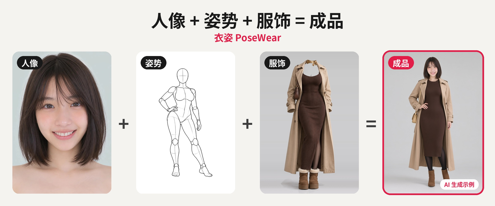
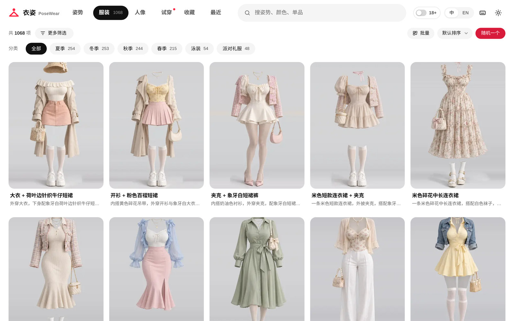
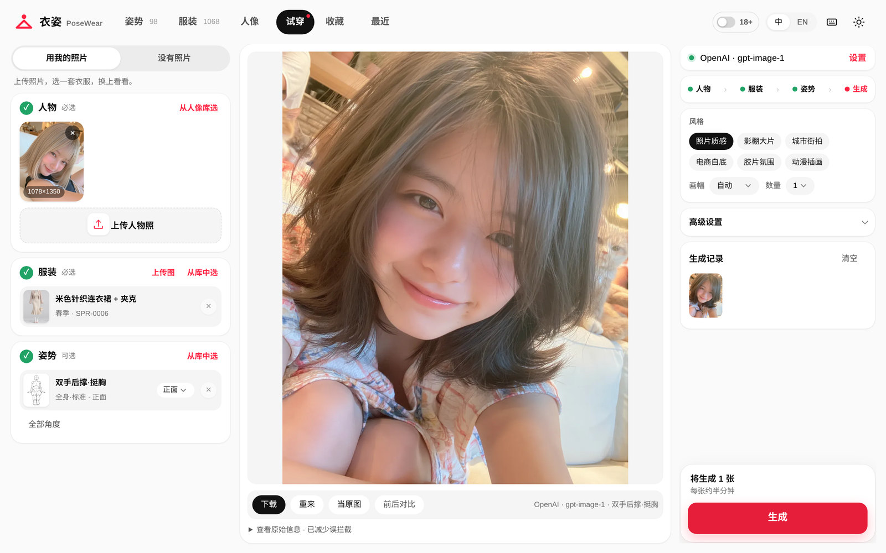
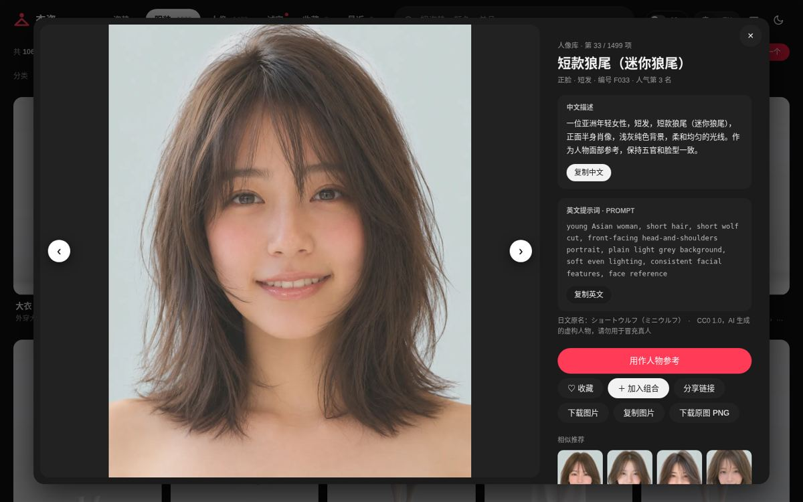
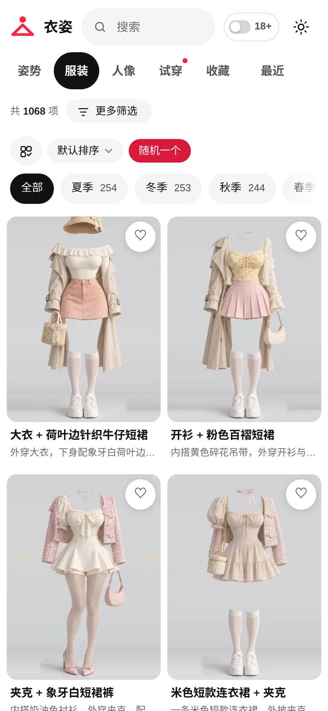

<div align="center">



<sub>成品为用站内人像、姿势、服装作参考的 AI 生成示例；素材版权归原作者，见<a href="#致谢">致谢</a>。</sub>


# 衣姿 PoseWear

姿势、服装、人像参考图库，附中英文提示词；用自己的 API Key，在浏览器里直接 AI 试穿。

[](LICENSE)
[](https://pages.cloudflare.com/)
[](https://posewear.pages.dev)
[](https://github.com/atuizz/posewear/stargazers)

[在线体验](https://posewear.pages.dev) · [功能](#功能) · [快速开始](#快速开始) · [部署](#部署) · [常见问题](#常见问题) · [English](README.en.md)



</div>

## 简介

衣姿是一个纯静态的参考图站点：三套素材库都能直接浏览、搜索和复制提示词。挑中的服装和姿势可以带到试穿工作台，配上你自己的照片和模型 API，生成试穿图。

不需要注册，也没有后端数据库。密钥、收藏和生成记录都只保存在你的浏览器里。

## 功能

| | |
|---|---|
| **素材库** | 姿势（多角度线稿）、深度姿势（热链原站深度图）、服装（按季节和类型分类）、人像（脸模参考，CC0）。每张图都有中文描述；深度姿势另附日文原名 |
| **搜索与筛选** | 中英文关键词、分类、排序、随机一张；每个素材有独立详情页，方便分享 |
| **试穿工作台** | 上传人物照，选服装和姿势，生成试穿图，或不用照片直接出图；一次可出多张，有前后对比、单张下载和打包下载 |
| **多家服务商** | OpenAI、Gemini、豆包 Seedream、OpenAI 兼容的自定义中转，见下表 |
| **生成记录** | 保存在本机 IndexedDB，可查看、删除、清空，并可撤销 |
| **清楚的报错** | 密钥无效、限流、超时、被安全审核拦截等情况会分别说明，并给出下一步可以怎么做 |
| **减少误拦截** | 默认开启。发送前把提示词改写成中性的电商试穿描述，不改变服装和姿势；关闭后按原样发送 |
| **收藏 / 最近 / 组合** | 本机保存，可导入导出，删除可撤销；可以把多个素材拼成一段提示词 |
| **18+ 开关** | 成人向分类默认隐藏，打开前需要确认年龄 |
| **PWA 与深色模式** | 可安装，看过的内容离线也能打开；深色模式跟随系统，也可手动切换 |
| **中文 / English 界面** | 默认中文，右上角切换 |

### 支持的服务商

| 服务商 | 需要准备 | 默认模型 | 说明 |
|---|---|---|---|
| OpenAI | API Key（gpt-image 需已验证组织） | gpt-image-1 | 走 images/edits，多张参考图；安全审核最严 |
| Gemini | Google AI Studio 的 API Key | gemini-2.5-flash-image | 即 Nano Banana |
| 豆包 Seedream | 火山方舟 API Key | doubao-seedream-4-0-250828 | 国内直连，默认经本站代理以解决跨域 |
| 自定义中转 | Base URL + Key + 模型名 | 自填 | OpenAI 兼容；可选 edits（multipart）或 generations（JSON） |

## 截图

| 试穿工作台 | 深色模式 | 手机 |
|:---:|:---:|:---:|
|  |  |  |

## 快速开始

需要 Python 3.9+ 和 Pillow；测试与部署另外需要 Node.js 18+。

```bash
git clone https://github.com/atuizz/posewear.git && cd posewear
pip install pillow

# 1. 从原作者的图库下载数据和图片到 ./assets-raw（数 GB，耗时较长）
python3 scripts/fetch-assets.py            # 也可只下部分：pose costume portrait

# 2. 构建到 dist/
python3 build.py

# 3. 本地预览 http://localhost:8787
python3 -m http.server 8787 -d dist
```

| 环境变量 | 作用 | 默认 |
|---|---|---|
| `POSEWEAR_RAW` | 原始素材目录 | `assets-raw` |
| `POSEWEAR_SITE` | 站点地址，用于 sitemap 和分享链接 | `https://posewear.pages.dev` |

## 部署

仓库不带素材，所以需要先在本地构建，再上传 `dist/` 到 Cloudflare Pages：

```bash
npm install
npx wrangler login
POSEWEAR_SITE=https://<你的项目名>.pages.dev python3 build.py
npx wrangler pages deploy dist --project-name <你的项目名>
```

- 第一次运行时，wrangler 会提示创建项目；之后同一条命令就是更新。
- `functions/api/proxy.js` 会作为 Pages Function 一起部署，只用于转发 API 请求。建议在 Cloudflare 控制台给 `/api/proxy` 加一条限流规则。
- CSP 等响应头由 `post.py` 生成在 `dist/_headers` 里。

## 测试

测试用 Playwright 拦截各服务商的接口，模拟成功、密钥错误、限流、5xx、超时、取消、安全拦截、多张输出等情况，不需要真实的 Key。

```bash
npm install && npx playwright install chromium
python3 -m http.server 8787 -d dist &
node tests/v12.js      # 图库、收藏、灯箱、路由、移动端
node tests/v13.js      # 试穿工作台全流程、深色模式、长文本
U=https://posewear.pages.dev node tests/v12.js   # 直接测线上
```

## 目录结构

```
src/                    前端源码，无框架
  app.js                图库、搜索筛选、收藏最近、灯箱、路由
  studio.js             试穿工作台：服务商适配、进度、结果、历史、减少误拦截
  extras.js             批量操作、导入导出
  style.css             样式（含深色模式）
  sw.js / zip.js        离线缓存 / 打包下载
functions/api/proxy.js  Pages Function，转发 API 请求
build.py / post.py      生成缩略图、数据、详情页、sitemap、_headers
costume_text.py         服装中英文描述
words.txt, tr_*.txt     词表与中英文翻译
depth/                  深度姿势素材包（只有文本，图片热链原站）
depthpack.py            把素材包编成可替换的 depths.json
scripts/                fetch-assets.py 下载素材，make-icons.js 生成图标
tests/                  Playwright 测试
docs/                   README 用图
```

## 常见问题

<details>
<summary><b>API Key 安全吗？</b></summary>

Key 只存在你浏览器的 localStorage 里，可在设置里清除。默认由浏览器直接请求服务商的官方接口。只有两种情况会经过本站的 `/api/proxy`：开启了「通过本站代理转发」，或使用自定义中转。这时它只按原样转发，不记录、不保存密钥和图片，并拒绝转发到内网地址。在公共电脑上用完记得清除。如果不放心，可以自己部署一份。
</details>

<details>
<summary><b>为什么会被「安全审核」拦下？</b></summary>

各家服务商都会审核输入的照片和生成的结果。真人照片配上泳装、内衣、露背等比较暴露的服装，最容易被拦，OpenAI 最严，Gemini 和 Seedream 相对宽松。「减少误拦截」可以降低正常穿搭被误判的概率，但不会、也不应该绕过对违规内容的审核。被拦时可以换一家服务商，或换一套服装。
</details>

<details>
<summary><b>素材可以商用吗？</b></summary>

本仓库不包含任何图片，素材版权归原作者所有，请以各原站的说明为准。人像库作者声明为 CC0。本仓库的 MIT 许可只覆盖代码和文案。
</details>

<details>
<summary><b>生成要多久、花多少钱？</b></summary>

通常每张半分钟左右，费用按你所用服务商的价格从你的账户扣除，本站不收费。
</details>

## 路线图

- [ ] 更多服务商与模型预设
- [ ] 生成记录导出
- [ ] 增量更新素材（只下载新增内容）
- [ ] 更完整的英文界面文案

欢迎在 [Issues](https://github.com/atuizz/posewear/issues) 里提建议。

## 参与贡献

欢迎提 Issue 和 PR：

1. Fork 后新建分支；
2. 改动前端后运行 `python3 build.py` 和 `node tests/v12.js && node tests/v13.js`；
3. PR 里说明改了什么，界面改动附截图。

文案请保持口语、简洁；不提交任何素材图片或密钥。

## 致谢

- [AI Pose Gallery](https://ai-pose-gallery.pages.dev/)：姿势线稿
- [AI Pose Depth Gallery](https://ai-pose-depth-gallery.pages.dev/)：深度姿势，作者 [ギア / @giaaibusi](https://x.com/giaaibusi)。页面热链原图，非官方汉化；图片不进本仓库
- [AI Costume Gallery](https://ai-costume-gallery.pages.dev/)：服装图，作者 [@giaaibusi](https://x.com/giaaibusi)
- [AI Portrait Gallery](https://ai-portrait-gallery.pages.dev/)：人像，作者 [@agi_aibusi](https://x.com/agi_aibusi)，CC0
- [wzc520pyfm/gen-ai-pose-image](https://github.com/wzc520pyfm/gen-ai-pose-image)、[paipiange/nvzhuang](https://github.com/paipiange/nvzhuang)：给了很多思路的同类项目

## 许可与素材边界

| 内容 | 是否在本仓库 | 许可 |
|---|---|---|
| 代码、页面文案、构建脚本 | 是 | [MIT](LICENSE) |
| 姿势、服装图片和原始数据 | 否，由 `fetch-assets.py` 从原站下载 | 归原作者 [@giaaibusi](https://x.com/giaaibusi) 所有（[AI Pose Gallery](https://ai-pose-gallery.pages.dev/) / [AI Costume Gallery](https://ai-costume-gallery.pages.dev/)），原站未标明开放许可 |
| 人像图片 | 否，同上 | [CC0 1.0](https://creativecommons.org/publicdomain/zero/1.0/deed.zh-hans)，作者 [@agi_aibusi](https://x.com/agi_aibusi)（[AI Portrait Gallery](https://ai-portrait-gallery.pages.dev/)） |
| 深度姿势图片 | 否，页面 `` 热链 [AI Pose Depth Gallery](https://ai-pose-depth-gallery.pages.dev/) | 归作者 [ギア / @giaaibusi](https://x.com/giaaibusi)。本仓库只有文本元数据和译名 |
| 深度姿势文本元数据 | 是，`depth/packs/` | 日文原文归原作者，中文译名为本站 |
| README 截图 | 是 | 截图里的图片素材同上，归各自作者 |

- MIT 只覆盖代码，不覆盖任何图片和数据。
- 想转载、商用或二次分发姿势、服装图片，请先联系原作者 @giaaibusi，以原站说明为准。
- 人像为 CC0，可商用、可修改、无需署名；均为 AI 生成的虚构人物，不要用来冒充真人。原作者希望不要原样批量转载。
- 自己部署时，请保留页面里的来源与作者说明。
