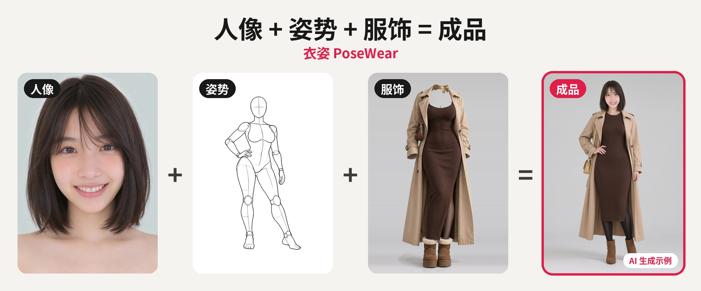
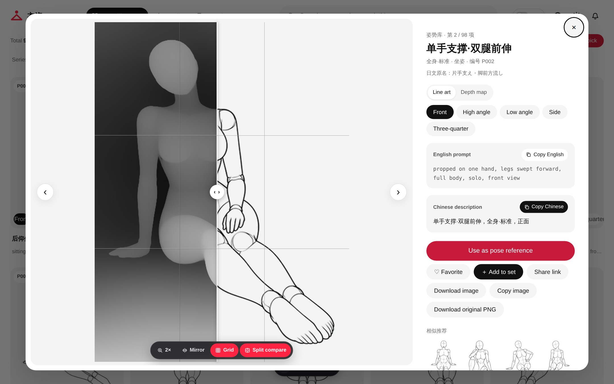
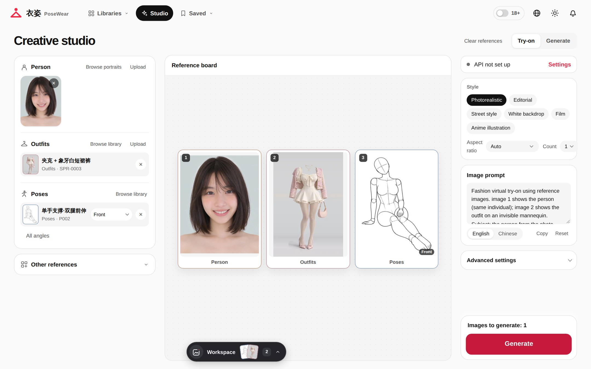
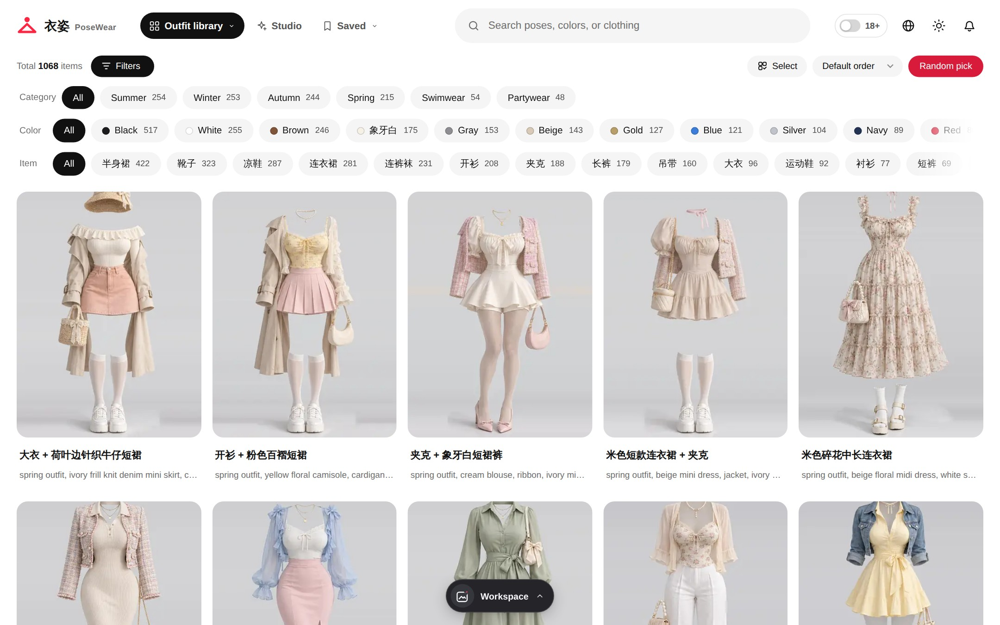
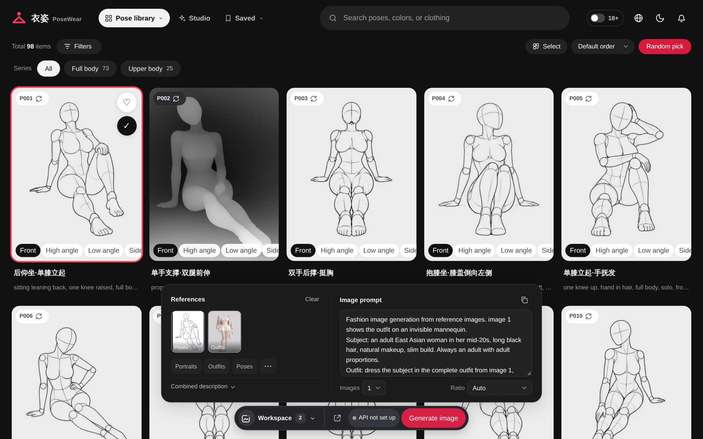

<div align="center">

<br>


# PoseWear

**Çizim, fotoğrafçılık ve yapay zeka ile görsel oluşturma için görsel referans kitaplığı ve tarayıcı tabanlı yaratıcı stüdyo**

12 özenle seçilmiş kitaplık · 5.700+ referans · Çift dilli Çince ve İngilizce istemler · Hesap yok, abonelik yok.

[](https://posewear.pages.dev/)
[](#bir-bak%C4%B1%C5%9Fta-on-iki-kitapl%C4%B1k)
[](CHANGELOG.md)
[](LICENSE)
[](https://github.com/atuizz/posewear/stargazers)

**[Canlı Site](https://posewear.pages.dev/)** · [Öne Çıkanlar](#%C3%B6ne-%C3%A7%C4%B1kanlar) · [Kitaplıklar](#bir-bak%C4%B1%C5%9Fta-on-iki-kitapl%C4%B1k) · [Oluşturma Modları](#g%C3%B6rsel-olu%C5%9Fturman%C4%B1n-%C3%BC%C3%A7-yolu) · [Yerelde Çalıştır](#yerelde-%C3%A7al%C4%B1%C5%9Ft%C4%B1r) · [简体中文](README.md) · [English](README.en.md) · [日本語](README.ja.md) · [Tiếng Việt](README.vi.md) · [Değişiklik Günlüğü](CHANGELOG.md)

<br>



<sub>Bir PoseWear portresi, pozu ve kıyafetiyle oluşturulmuş örnek görsel. Kaynak görsel hakları ilgili yaratıcılarına aittir; aşağıdaki Kaynaklar ve Lisanslar bölümüne bakın.</sub>

</div>

> [!CAUTION]
> **Sahte sitelere dikkat edin**: Resmi erişim yalnızca [posewear.pages.dev](https://posewear.pages.dev/) ve bu depo üzerindendir — ücretsizdir, hesap veya ücretli plan yoktur. PoseWear'in Windows veya Android uygulaması yoktur ve hiçbir dosya paylaşım servisi üzerinden exe/apk olarak dağıtılmaz. Resmi olduğunu iddia eden, exe/apk indirmesi sunan ya da giriş/ödeme talep eden `posewear.cn` ve `posewear.art` gibi siteler taklittir — oralardan indirme yapmayın, giriş yapmayın, ödeme yapmayın veya API anahtarı girmeyin.

---

## Öne Çıkanlar

### Sanatçı Işık Kutusu Stüdyosu · Canlı Çizgi Sanatı × Derinlik Bölünmüş Karşılaştırma

<p align="center">
  
</p>

Her poz, birebir aynı kamera açısından bir **çizgi eskizi** ve **eşleşen derinlik haritasıyla** birlikte gelir. Herhangi bir kartı rozetinden olduğu yerde çevirin veya yerleşik sanatçı araçlarıyla incelemek için ışık kutusunu açın:

- **`Z` / Çift tıklama**: Kıvrımlar, eller ve perspektif ayrıntıları için sürüklenebilir 2× yakınlaştırma
- **`H` Ayna**: Denge ve anatomik oranları kontrol etmek için anında yatay çevirme
- **`G` Kompozisyon Izgarası**: Üçler kuralı ile merkez eksen / çeyrek oran kılavuzları arasında geçiş
- **`B` Gri Tonlama Değer Çalışması ve Otomatik Renk Paleti**: Ton çalışması için gri tonlamaya geçin ve renkli fotoğraflardan en fazla 5 gerçek `#HEX` renk örneği çıkarın (tek tıkla kopyalayın)
- **`V` Bölünmüş Karşılaştırma**: Aynı açıdaki çizgi sanatı ile derinlik haritası arasında canlı perde sürükleyin

---

### Yaratıcı Stüdyo · Numaralı Referans Panosu ve Sanal Deneme

<p align="center">
  
</p>

<table>
  <tr>
    <td width="33.3%" valign="top">
      <br>
      <b>Görsel Renk Örnekleri ve Çift Dilli İstemler</b><br>
      <sub>Kıyafetleri gerçek renk örneklerine göre filtreleyin; bir kartı veya seti kopyaladığınızda tam açıdaki herkese açık görsel bağlantıları da eklenir.</sub>
    </td>
    <td width="33.3%" valign="top">
      <br>
      <b>Koyu Tuval ve Yüzen Çalışma Alanı</b><br>
      <sub>Galeriden ayrılmadan referans toplayın, panelde istemleri düzenleyin ve anında görsel oluşturun.</sub>
    </td>
    <td width="33.3%" valign="top">
      <br>
      <b>Dokunmatik ve Mobil İçin Tasarlandı</b><br>
      <sub>Telefonda pozları çevirin, açıları değiştirin, setler oluşturun ve geçmişi rahatça inceleyin.</sub>
    </td>
  </tr>
</table>

<table>
  <tr>
    <td width="50%" valign="top">
      <b>Numaralı Pano ve Tek Tıkla Moodboard PNG Dışa Aktarımı</b><br>
      Her kart, istemdeki <code>image 1 / 2 / 3</code> ile eşleşen gönderim sırasını (<code>1 / 2 / 3</code>) ve kamera açısını gösterir. Görünümleri karıştırın, Geri Al ile temizleyin ve Midjourney, Kling, PureRef veya paylaşım için hazır <b>yüksek çözünürlüklü referans sayfası PNG'si dışa aktarın</b>.
    </td>
    <td width="50%" valign="top">
      <b>Tam Ekran Hızlı Eskiz Stüdyosu</b><br>
      Mevcut filtrelenmiş galerinizden dikkat dağıtmayan zamanlayıcılı bir pratik oturumu başlatın: <code>30s / 60s / 2m / 5m</code> zamanlayıcılar, <code>5 / 10 / 20 / Sınırsız</code> desteler, isteğe bağlı uyarı sesi, ayna / ızgara / gri tonlama / derinlik çevirme araçları ve tıklanabilir oturum özeti.
    </td>
  </tr>
  <tr>
    <td width="50%" valign="top">
      <b>Referans İzlenebilirliğine Sahip Yerel Geçmiş</b><br>
      Oluşturulan çıktılar tarayıcınızın IndexedDB depolamasında kalır; mod filtreleri (Deneme / Oluşturma), istem/model arama, ışık kutusu içinde kullanılan tam referansların tıklanabilir küçük resimleri, tekli indirme ve toplu ZIP dışa aktarımı sunar.
    </td>
    <td width="50%" valign="top">
      <b>Genel Komut Paleti (⌘K) ve Hızlı Seçici</b><br>
      12 kitaplığın tamamına atlamak, arama yapmak, Eskiz Stüdyosu'nu başlatmak veya tema ve dil değiştirmek için her yerden <code>⌘K</code> / <code>Ctrl+K</code> tuşlarına basın; stüdyo seçicisi kategori etiketleri, yalnızca Favoriler filtresi ve sürükle-bırak yükleme ekler.
    </td>
  </tr>
</table>

---

## Bir Bakışta On İki Kitaplık

| Grup | Kitaplıklar | Öğe | Öne Çıkanlar |
| :--- | :--- | :---: | :--- |
| **Hareket** | Pozlar · Derinlik pozları | `288` × 2 | Eşleştirilmiş çizgi eskizleri ve derinlik haritaları, çoklu açılar, kart içi çevirme ve ışık kutusunda bölünmüş karşılaştırma |
| **İnsan** | Portreler · İfadeler · Saç stilleri | `1.499` / `95` / `122` | CC0 kurgusal portreler, ICT-FaceKit ifade yoğunluğu filtreleri, çok renkli saç stili varyantları |
| **Giyim** | Kıyafetler · Anime kıyafetleri · Tarihsel kıyafetler | `1.407` / `1.760` / `57` | Modern, anime ve dönem kıyafetlerini kapsayan görsel renk örnekleri ve parça filtreleri |
| **Ortam** | Sahneler · Aydınlatma · Aksesuarlar · Mobilya | `64` / `50` / `32` / `41` | Tam sahne kompozisyonu için çok açılı mekanlar, ışık kurulumları, aksesuarlar ve mobilyalar |

---

## Görsel Oluşturmanın Üç Yolu

| Mod | En Uygun Kullanım | Nasıl Çalışır |
| :--- | :--- | :--- |
| **Bulut API Anahtarı** | En hızlı kurulum ve en güçlü çoklu görsel modelleri | OpenAI, Gemini, Seedream veya herhangi bir OpenAI / Gemini / xAI uyumlu aracı uç noktaya bağlanın. Doğrudan tarayıcınızdan veya site proxy'si üzerinden gönderin (özel uç noktalar için `http`/`https` ve tüm portlar desteklenir). |
| **Yerel Motor** | Tam gizlilik ve sıfır API maliyeti | Kendi makinenizde çalışan **ComfyUI** veya **stable-diffusion.cpp** (`sd-server`) sunucusuna bağlanın — görseller cihazınızdan hiç çıkmaz. Yerleşik tek referanslı ve özel çok referanslı ComfyUI API iş akışlarını destekler. [Kurulum kılavuzu →](docs/local-engines.md) |
| **Yapay Zeka Ajanı (MCP)** | Codex / Claude içinde otomatik referans arama | Ajanınızın 12 kitaplıkta arama yapması, tam açıları seçmesi ve görsel bağlantılı özetler hazırlaması için salt okunur bir stdio MCP sunucusu ve referans seçme yeteneği içerir. [MCP kılavuzu →](mcp/README.md) |

```sh
# MCP sunucusunu bağlayın (Codex örneği)
codex mcp add posewear -- node "$PWD/mcp/server.mjs"
```

> Ardından şunu istemeniz yeterli: “İlkbahar kıyafetli, yandan oturan bir poz bul — istemi ve referans bağlantılarını ver.”

---

## Yerelde Çalıştır

**Node.js 22.12+** gerektirir — paketleyici yok, veritabanı yok:

```sh
git clone https://github.com/atuizz/posewear.git
cd posewear
npm ci
npm start
```

`http://127.0.0.1:8787/` adresini açın. Gezinme, favoriler ve kopyalama için hesap veya API anahtarı gerekmez; kataloglar ilk açılışta herkese açık siteden, görseller ise talep üzerine yüklenir.

- **Hesap yok**: kayıt yok, sunucu tarafında izleme yok
- **Tarayıcıda yerel durum**: favoriler, ayarlar ve API anahtarları `localStorage` içinde; geçmiş IndexedDB içinde saklanır
- **Temiz kaldırma**: site verilerini temizlemek tüm yerel verileri anında siler

<details>
<summary><b>Klavye Kısayolları</b></summary>

| Tuş | İşlem |
| :---: | :--- |
| `⌘K` / `Ctrl+K` | Genel Komut Paleti'ni aç (kitaplıklar, arama, Eskiz Stüdyosu, ayarlar) |
| `/` | Aramaya odaklan |
| `R` | Rastgele bir referans seç |
| `T` | Açık / koyu temayı değiştir (galeri ve ışık kutusunda çalışır) |
| `L` | Referans açıklama dilini değiştir (ZH / EN) |
| `1` – `9` | Kitaplıklar arasında geçiş yap |
| `←` `→` / `↑` `↓` | Işık kutusu: önceki / sonraki öğe, kamera açısını değiştir |
| `Z` / `H` / `G` / `B` / `V` | Işık kutusu: 2× yakınlaştırma / ayna / kompozisyon ızgarası / gri tonlama değer kontrolü / bölünmüş derinlik karşılaştırması |
| `Space` | Eskiz Stüdyosu: zamanlayıcıyı duraklat / devam ettir |
| `F` / `A` / `C` / `S` | Işık kutusu: favorilere ekle / sete ekle / istemi kopyala / bağlantıyı paylaş |
| `Esc` | Işık kutusunu, Eskiz Stüdyosu'nu, Komut Paleti'ni veya pencereyi kapat |

</details>

---

## Geliştirme ve Testler

Tamamen statik mimari: **saf JS + Python derleme + Cloudflare Pages** (framework yok, bundler yok). Varlık kurulumu, derleme adımları ve dağıtım kontrolleri için [AGENTS.md](AGENTS.md) dosyasına bakın.

```sh
# Çevrimdışı regresyon paketi (varlık arşivi olmadan doğrudan kaynak koddan çalışır)
npm run test:offline

# Tam site regresyon paketi (yerel önizleme veya staging derlemesine karşı)
npm test
```

Güncel sürüm **v1.4.0** (2026-11-25) · [Tam değişiklik günlüğü](CHANGELOG.md)

---

## Kaynaklar ve Lisanslar

Kod, arayüz metinleri ve derleme betikleri [MIT](LICENSE) lisansı altındadır. Kendi sunucunuzda barındırma, çatallama (fork), istemci olarak paketleme veya ticari işletme serbesttir — **tek bir koşulla: PoseWear adını kullanmayın, resmi projeyi taklit etmeyin ve kaynağa atıf yapın**.

Görsel hakları kod lisansından ayrıdır: aşağıdaki bazı üst galeriler ticari kullanımı veya yeniden dağıtımı kısıtlar. Herhangi bir ticari kullanım öncesinde hakları orijinal yaratıcılarla kendi sorumluluğunuzda netleştirin.

| Kitaplıklar | Kaynak ve Lisans |
| :--- | :--- |
| Pozlar, derinlik pozları, kıyafetler, anime kıyafetleri | ギア / [@giaaibusi](https://x.com/giaaibusi) — ticari kullanım veya yeniden dağıtım öncesinde yaratıcıyla iletişime geçin. [Eskizler](https://ai-pose-gallery.pages.dev/) · [Derinlik](https://ai-pose-depth-gallery.pages.dev/) · [Kıyafetler](https://ai-costume-gallery.pages.dev/) · [Anime kıyafetleri](https://ai-costume-anime-gallery.pages.dev/) |
| Portreler | @agi_aibusi tarafından oluşturulan kurgusal yapay zeka portreleri (CC0); lütfen değiştirilmeden toplu yeniden paylaşım yapmayın. [AI Portrait Gallery](https://ai-portrait-gallery.pages.dev/) |
| Saç stilleri ve seçili anime kıyafetleri | たき AI / CharaDB — etiketler CC0, görseller kaynaktan doğrudan yüklenir. [CharaDB](https://charadb-2fi.pages.dev/) |
| İfadeler | WaveSpeed AI Emotion Gallery; kafa modeli ICT-FaceKit (© USC Institute for Creative Technologies, MIT) |
| Tarihsel kıyafetler, sahneler, aydınlatma, aksesuarlar, mobilya | Shisei / wquguru (CC0 1.0) |

<div align="center">

<br>

<sub><a href="https://github.com/wzc520pyfm/gen-ai-pose-image">gen-ai-pose-image</a> ve <a href="https://github.com/paipiange/nvzhuang">nvzhuang</a> projelerinden ilham alınmıştır — teşekkürler.</sub>

</div>
