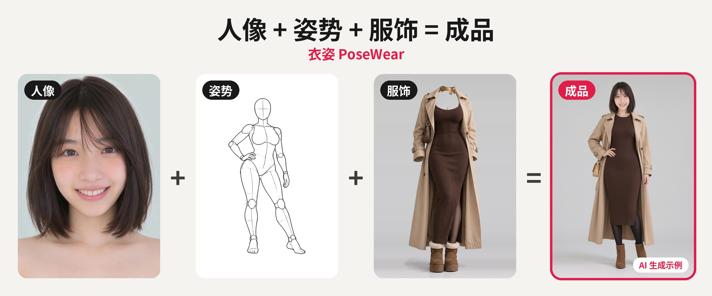
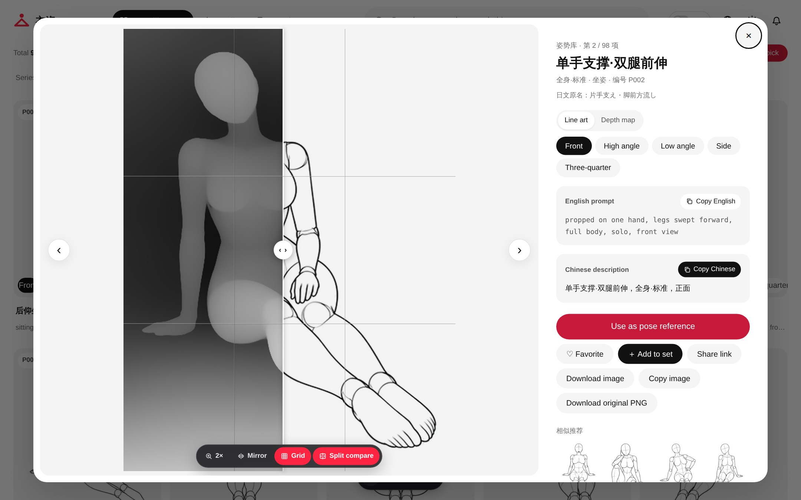
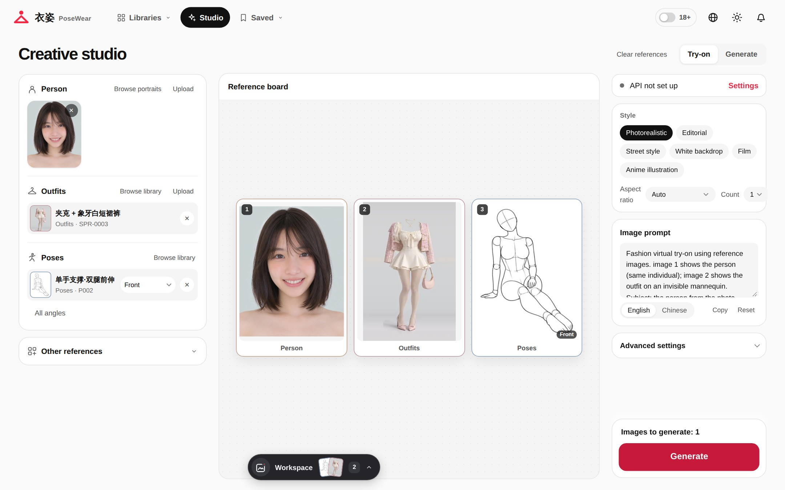
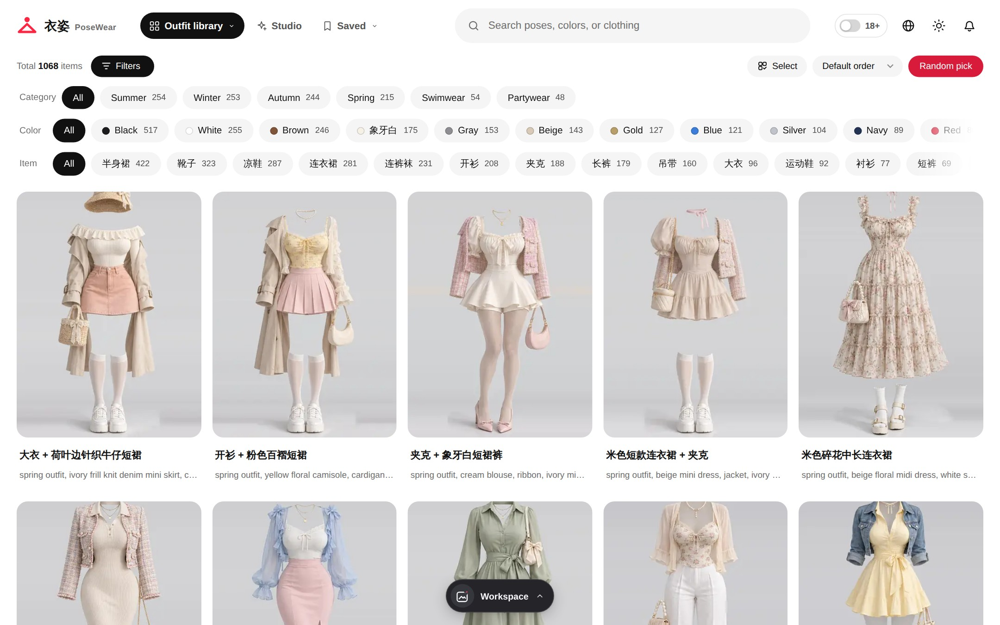
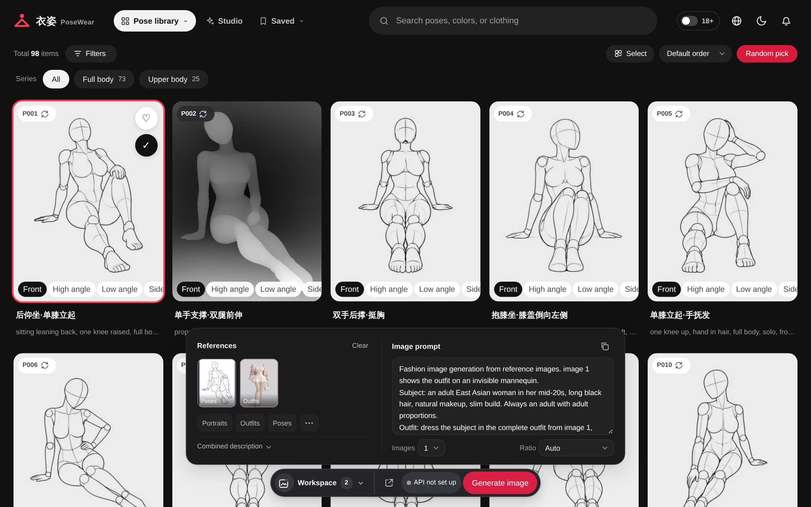

<div align="center">

<br>


# PoseWear

**Thư viện ảnh tham chiếu & studio sáng tạo trên trình duyệt cho vẽ, nhiếp ảnh và tạo ảnh AI**

12 thư viện chọn lọc · Hơn 5.700 tư liệu tham chiếu · Prompt song ngữ Trung & Anh · Mở là dùng, không tài khoản, không gói trả phí.

[](https://posewear.pages.dev/)
[](#tổng-quan-12-thư-viện)
[](CHANGELOG.md)
[](LICENSE)
[](https://github.com/atuizz/posewear/stargazers)

**[Dùng trực tuyến](https://posewear.pages.dev/)** · [Điểm nổi bật](#điểm-nổi-bật) · [12 thư viện](#tổng-quan-12-thư-viện) · [Cách tạo ảnh](#ba-cách-tạo-ảnh) · [Chạy cục bộ](#chạy-cục-bộ) · [简体中文](README.md) · [English](README.en.md) · [日本語](README.ja.md) · [Türkçe](README.tr.md) · [Nhật ký thay đổi](CHANGELOG.md)

<br>



<sub>Ví dụ do AI tạo bằng chân dung, tư thế và trang phục từ PoseWear làm tham chiếu. Quyền hình ảnh nguồn thuộc về các tác giả gốc; xem mục Nguồn và giấy phép bên dưới.</sub>

</div>

> [!CAUTION]
> **Cẩn thận với trang mạo danh**: kênh chính thức duy nhất là [posewear.pages.dev](https://posewear.pages.dev/) và kho mã nguồn này — hoàn toàn miễn phí, không cần tài khoản và không có gói trả phí. PoseWear không có ứng dụng Windows hay Android, và không bao giờ phân phối tệp exe/apk qua bất kỳ dịch vụ chia sẻ tệp nào. Các trang như `posewear.cn` hay `posewear.art` tự xưng chính thức, cung cấp tải exe/apk hoặc yêu cầu đăng nhập, trả tiền đều là giả mạo — tuyệt đối không tải xuống, đăng nhập, thanh toán hay nhập API Key tại đó.

---

## Điểm nổi bật

### Trình xem tham chiếu cho họa sĩ · So sánh kéo màn Phác thảo × Bản đồ độ sâu

<p align="center">
  
</p>

Mỗi tư thế đều có cặp **phác thảo nét vẽ** và **bản đồ độ sâu** trùng khớp từng góc chụp. Nhấn vào mã thẻ để lật tại chỗ, hoặc mở xem lớn để dùng thanh công cụ kiểm tra chuyên dụng cho vẽ:

- **`Z` / Nhấp đúp ảnh**: phóng to 2× và kéo tự do để soi nếp vải, bàn tay và phối cảnh khớp
- **`H` Lật ngang**: lật gương ngay lập tức để kiểm tra trọng tâm và tỷ lệ đối xứng cơ thể
- **`G` Lưới bố cục**: chuyển vòng giữa lưới 1/3 và trục tâm đỏ + lưới chia tư
- **`B` Kiểm tra sắc độ xám & Bảng màu tự động**: chuyển đen trắng để kiểm tra sáng tối, đồng thời tự trích xuất tối đa 5 mã màu `#HEX` chủ đạo từ ảnh màu (nhấn để sao chép)
- **`V` So sánh kéo màn**: kéo rèm trực tiếp giữa bản phác thảo và bản đồ độ sâu cùng góc chụp

---

### Studio sáng tạo · Bảng tham chiếu đánh số & Thử đồ ảo

<p align="center">
  
</p>

<table>
  <tr>
    <td width="33.3%" valign="top">
      <br>
      <b>Lọc ô màu trực quan × Prompt song ngữ</b><br>
      <sub>Lọc trang phục bằng chấm màu thực tế; khi sao chép thẻ đơn hay cả bộ đều tự kèm liên kết ảnh đúng góc đã chọn.</sub>
    </td>
    <td width="33.3%" valign="top">
      <br>
      <b>Nền tối × Không gian làm việc nổi</b><br>
      <sub>Vừa duyệt vừa gom tư liệu không bị gián đoạn, chỉnh prompt và tạo ảnh ngay trong thanh nổi cuối màn hình.</sub>
    </td>
    <td width="33.3%" valign="top">
      <br>
      <b>Tối ưu cảm ứng trên di động</b><br>
      <sub>Lật tư thế, đổi góc chụp, chọn tư liệu, tạo ảnh và xem lại lịch sử gọn gàng ngay trên điện thoại.</sub>
    </td>
  </tr>
</table>

<table>
  <tr>
    <td width="50%" valign="top">
      <b>Bảng đánh số khớp prompt · Xuất bảng PNG một chạm</b><br>
      Mỗi thẻ hiển thị thứ tự gửi (<code>1 / 2 / 3</code>) và góc chụp khớp với <code>image 1 / 2 / 3</code> trong prompt. Hỗ trợ «Đổi bộ khác», xóa nhanh có hoàn tác và <b>xuất bảng tham chiếu ghép PNG độ phân giải cao</b> cho Midjourney, Kling, PureRef hoặc chia sẻ nhóm.
    </td>
    <td width="50%" valign="top">
      <b>Luyện ký họa toàn màn hình (Gesture Studio)</b><br>
      Vào thẳng buổi luyện tập không xao nhãng từ danh sách đang lọc — hẹn giờ <code>30s / 60s / 2m / 5m</code>, số lượng <code>5 / 10 / 20 / Không giới hạn</code>, âm báo tùy chọn, lật ngang / lưới / đen trắng / đổi độ sâu và bảng tổng kết có thể nhấn xem lại.
    </td>
  </tr>
  <tr>
    <td width="50%" valign="top">
      <b>Lịch sử cục bộ & Truy vết ảnh tham chiếu</b><br>
      Toàn bộ ảnh tạo ra được lưu trong IndexedDB của trình duyệt, hỗ trợ lọc theo chế độ (Thử đồ / Tạo ảnh), tìm prompt hoặc mô hình, xem lại dải ảnh tham chiếu đã dùng trong trình xem lớn, tải đơn lẻ hoặc xuất ZIP hàng loạt.
    </td>
    <td width="50%" valign="top">
      <b>Bảng lệnh toàn cục (⌘K) & Bộ chọn nhanh</b><br>
      Nhấn <code>⌘K</code> / <code>Ctrl+K</code> ở bất kỳ đâu để nhảy nhanh tới 12 thư viện, tìm kiếm, mở luyện ký họa hay đổi giao diện; bộ chọn trong Studio có lọc danh mục, «Chỉ xem yêu thích» và kéo-thả tải ảnh nhân vật/trang phục.
    </td>
  </tr>
</table>

---

## Tổng quan 12 thư viện

| Nhóm | Thư viện | Số lượng | Điểm nổi bật |
| :--- | :--- | :---: | :--- |
| **Tư thế** | Tư thế · Tư thế độ sâu | `288` × 2 | Phác thảo và bản đồ độ sâu đi theo cặp đúng góc chụp, lật tại chỗ & kéo màn so sánh |
| **Nhân vật** | Chân dung · Biểu cảm · Kiểu tóc | `1.499` / `95` / `122` | Chân dung hư cấu CC0, biểu cảm ICT-FaceKit phân cấp cường độ, nhiều biến thể màu tóc |
| **Trang phục** | Trang phục · Trang phục anime · Cổ phục | `1.407` / `1.760` / `57` | Lọc theo ô màu và món đồ, bao phủ trang phục đời thường, anime và trang phục cổ đại |
| **Bối cảnh & Vật dụng** | Bối cảnh · Ánh sáng · Đạo cụ · Nội thất | `64` / `50` / `32` / `41` | Đa góc nhìn, hoàn thiện không gian, nguồn sáng, đạo cụ cầm tay và bày trí |

---

## Ba cách tạo ảnh

| Cách dùng | Phù hợp khi | Cơ chế hoạt động |
| :--- | :--- | :--- |
| **API Key đám mây** | Muốn dùng ngay các mô hình chỉnh sửa đa ảnh mạnh nhất | Hỗ trợ OpenAI, Gemini, Seedream hoặc bất kỳ relay tương thích OpenAI / Gemini / xAI nào. Gửi trực tiếp từ trình duyệt hoặc qua proxy của trang (relay tùy chỉnh hỗ trợ `http`/`https` và mọi cổng). |
| **Engine cục bộ** | Ưu tiên riêng tư tuyệt đối, không tốn phí API | Kết nối trực tiếp **ComfyUI** hoặc **stable-diffusion.cpp** (`sd-server`) chạy trên máy của bạn — ảnh không rời khỏi thiết bị. Hỗ trợ workflow đơn ảnh dựng sẵn và workflow ComfyUI đa ảnh tùy chỉnh. [Hướng dẫn thiết lập →](docs/local-engines.md) |
| **AI Agent (MCP)** | Giao cho Codex / Claude tự tìm ảnh tham chiếu | Kèm máy chủ MCP stdio chỉ đọc và Skill chọn ảnh để agent tự tra cứu 12 thư viện, chọn đúng góc chụp và lắp prompt kèm đường dẫn ảnh. [Tài liệu MCP →](mcp/README.md) |

```sh
# Kết nối MCP cục bộ (ví dụ với Codex)
codex mcp add posewear -- node "$PWD/mcp/server.mjs"
```

> Sau khi kết nối, chỉ cần hỏi: «Tìm một tư thế ngồi góc nghiêng kèm một bộ đồ mùa xuân, gửi mình prompt và đường dẫn ảnh tham chiếu.»

---

## Chạy cục bộ

Yêu cầu **Node.js 22.12+** — không cần bundler, không cần cơ sở dữ liệu:

```sh
git clone https://github.com/atuizz/posewear.git
cd posewear
npm ci
npm start
```

Mở `http://127.0.0.1:8787/`. Duyệt thư viện, lưu yêu thích và sao chép prompt đều không cần tài khoản hay API Key; danh mục công khai được nạp ở lần mở đầu và hình ảnh tải theo nhu cầu.

- **Không tài khoản**: không đăng ký, không theo dõi phía máy chủ
- **Lưu hoàn toàn trên máy**: yêu thích, cài đặt và API Key chỉ nằm trong `localStorage`; lịch sử tạo ảnh nằm trong IndexedDB
- **Xóa sạch tức thì**: xóa dữ liệu trang web trên trình duyệt là dọn hết mọi trạng thái cục bộ

<details>
<summary><b>Phím tắt thường dùng</b></summary>

| Phím | Chức năng |
| :---: | :--- |
| `⌘K` / `Ctrl+K` | Mở bảng lệnh toàn cục (chuyển thư viện, tìm kiếm, luyện ký họa, cài đặt) |
| `/` | Đưa con trỏ vào ô tìm kiếm |
| `R` | Chọn ngẫu nhiên một tư liệu |
| `T` | Chuyển giao diện sáng / tối (dùng được cả trong thư viện và trình xem lớn) |
| `L` | Đổi ngôn ngữ mô tả tư liệu (Trung / Anh) |
| `1` – `9` | Nhảy nhanh giữa các thư viện |
| `←` `→` / `↑` `↓` | Trình xem lớn: chuyển mục trước / sau, đổi góc chụp |
| `Z` / `H` / `G` / `B` / `V` | Trình xem lớn: phóng 2× / lật ngang / lưới bố cục / sắc độ xám / so sánh phác thảo & độ sâu |
| `Space` | Luyện ký họa: tạm dừng / tiếp tục đồng hồ |
| `F` / `A` / `C` / `S` | Trình xem lớn: yêu thích / thêm vào bộ / sao chép prompt / sao chép liên kết chia sẻ |
| `Esc` | Đóng trình xem lớn, luyện ký họa, bảng lệnh hoặc hộp thoại |

</details>

---

## Phát triển & Kiểm thử

Kiến trúc thuần tĩnh: **JS thuần + kịch bản dựng Python + Cloudflare Pages** (không framework, không bundler). Giao diện hỗ trợ bốn ngôn ngữ: Tiếng Trung giản thể, Tiếng Anh, Tiếng Nhật và Tiếng Việt. Xem [AGENTS.md](AGENTS.md) để biết chi tiết dựng bản phát hành và triển khai.

```sh
# Bộ kiểm thử hồi quy ngoại tuyến (không cần kho ảnh gốc)
npm run test:offline

# Bộ kiểm thử toàn trang (chạy cùng bản xem trước cục bộ hoặc staging)
npm test
```

Phiên bản hiện tại **v1.4.0** (2026-11-25) · [Xem toàn bộ nhật ký thay đổi](CHANGELOG.md)

---

## Nguồn và giấy phép

Mã nguồn, văn bản giao diện và kịch bản dựng phát hành theo giấy phép [MIT](LICENSE): cho phép tự triển khai, phát triển tiếp, đóng gói ứng dụng hoặc vận hành thương mại — **với một điều kiện duy nhất: không sử dụng tên PoseWear, không mạo danh dự án chính thức và ghi rõ nguồn**.

Bản quyền hình ảnh tách biệt với giấy phép mã nguồn: một số thư viện nguồn dưới đây hạn chế sử dụng thương mại hoặc phân phối lại. Hãy tự liên hệ xác nhận quyền với tác giả gốc trước khi dùng cho mục đích thương mại.

| Thư viện | Nguồn & Giấy phép |
| :--- | :--- |
| Tư thế, tư thế độ sâu, trang phục, trang phục anime | ギア / [@giaaibusi](https://x.com/giaaibusi) — vui lòng liên hệ tác giả trước khi dùng thương mại hoặc đăng lại. [Phác thảo](https://ai-pose-gallery.pages.dev/) · [Độ sâu](https://ai-pose-depth-gallery.pages.dev/) · [Trang phục](https://ai-costume-gallery.pages.dev/) · [Trang phục anime](https://ai-costume-anime-gallery.pages.dev/) |
| Chân dung | Chân dung AI hư cấu của @agi_aibusi (CC0); tác giả mong không sao chép hàng loạt nguyên trạng. [AI Portrait Gallery](https://ai-portrait-gallery.pages.dev/) |
| Kiểu tóc & một phần trang phục anime | たき AI / CharaDB — nhãn CC0, ảnh tải trực tiếp từ trang gốc. [CharaDB](https://charadb-2fi.pages.dev/) |
| Biểu cảm | WaveSpeed AI Emotion Gallery; mô hình đầu ICT-FaceKit (© USC Institute for Creative Technologies, MIT) |
| Cổ phục, bối cảnh, ánh sáng, đạo cụ, nội thất | Shisei / wquguru (CC0 1.0) |

<div align="center">

<br>

<sub>Lấy cảm hứng từ <a href="https://github.com/wzc520pyfm/gen-ai-pose-image">gen-ai-pose-image</a> và <a href="https://github.com/paipiange/nvzhuang">nvzhuang</a> — xin chân thành cảm ơn.</sub>

</div>
